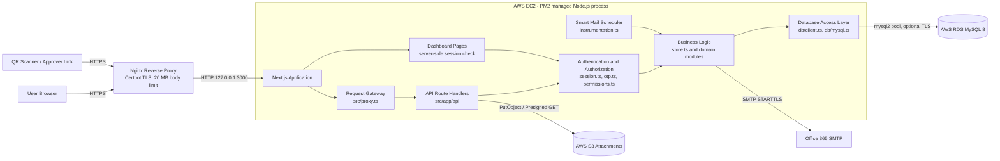
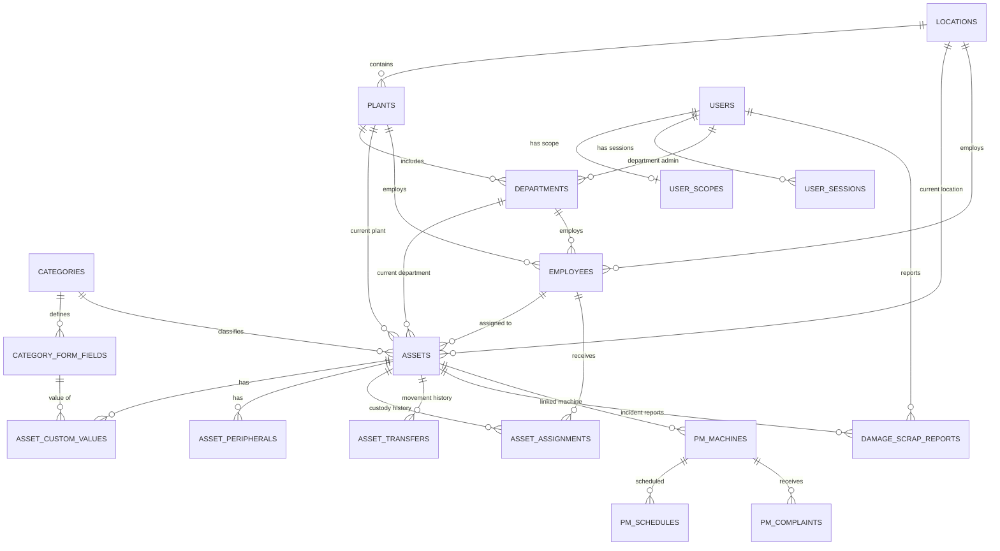
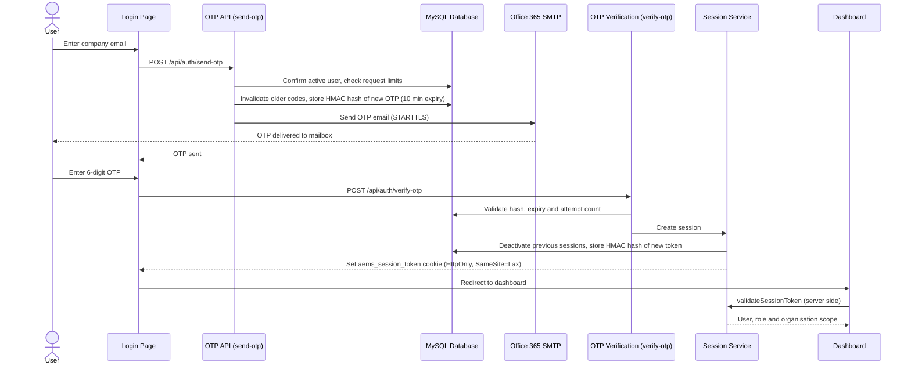
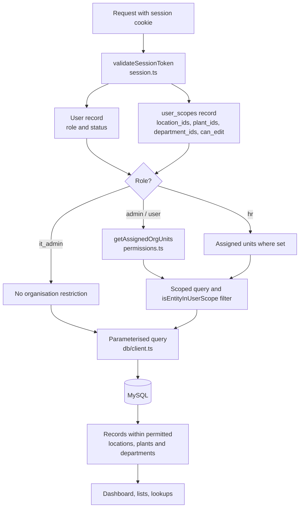
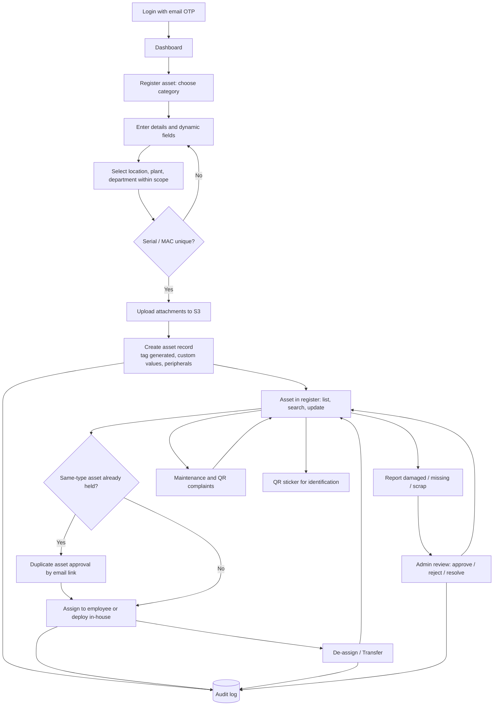
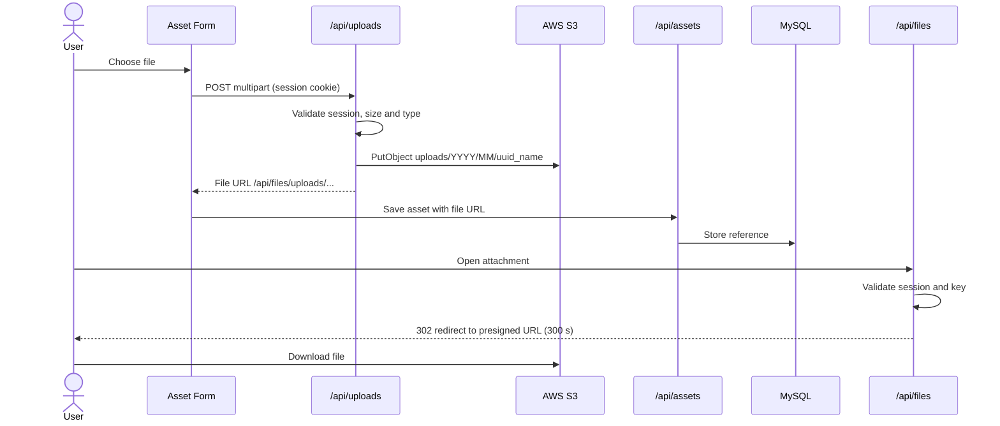
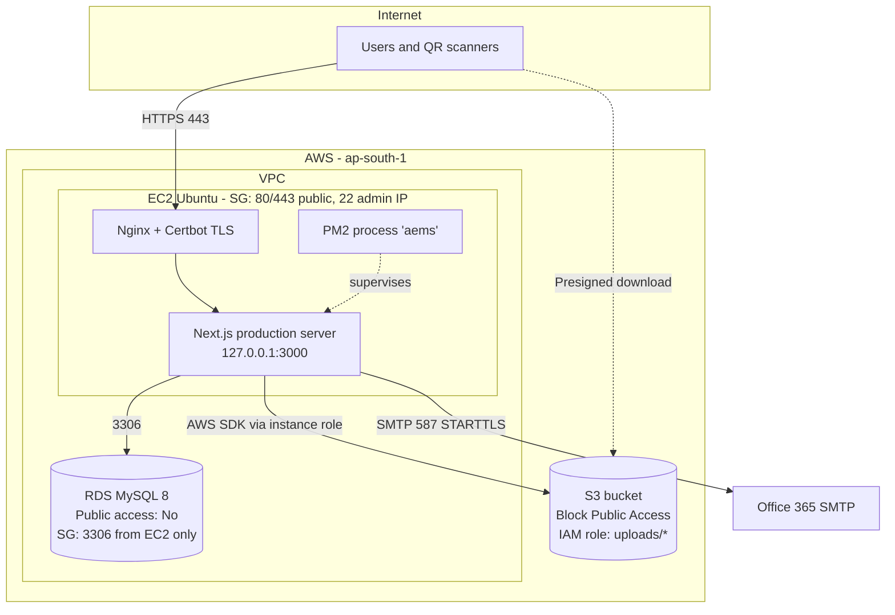

# AEMS – Complete Technical Documentation

**AEMS – Asset Entry Management System**
**PG Electroplast Ltd**

---

## 1. Cover Page and Document Information

| Field | Details |
|---|---|
| Document title | AEMS – Complete Technical Documentation |
| Application name | AEMS – Asset Entry Management System |
| Organization | PG Electroplast Ltd |
| Document purpose | To describe the architecture, technology stack, database design, implemented security features, user roles, business workflows and step-by-step operation of AEMS |
| Document version | 1.0 |
| Preparation date | 9 October 2026 |
| Source baseline | Repository branch `vikas-security-scope-updates` (commit `73d1d4e`) including the current working-tree updates for multi-department administrator scope |
| Intended audience | IT Management, IT Operations, Developers, System Administrators and Internal Audit |
| Document classification | Internal – Confidential |

### Table of Contents

1. Cover Page and Document Information
2. Executive Overview
3. Application Features and Business Modules
4. Technology Stack
5. Technical Architecture
6. Database Design and Architecture
7. Database Security Architecture
8. Authentication and Login Process
9. Role-Based Access Control
10. Implemented Application Security Features
11. User Scope and Plant-Level Data Management
12. Complete Asset Lifecycle Workflow
13. Step-by-Step User SOP
14. Administrator SOP
15. API and Backend Reference
16. File Storage and Attachment Handling
17. Audit Logging and Operational Traceability
18. Reporting and Dashboard
19. Deployment Architecture
20. Application Configuration Reference
21. Error Handling and Troubleshooting
22. Technical Maintenance and Support
23. Technical Glossary
24. References and Technical Evidence

> **Documentation basis:** All technical statements in this document were verified against the application source code, database schema and deployment files in the repository. Infrastructure items are described as documented in the repository's deployment guide (`aws/DEPLOY.md`) and templates. No credentials, secret values or personal data are reproduced in this document.

---

## 2. Executive Overview

### 2.1 Purpose of AEMS

AEMS (Asset Entry Management System) is PG Electroplast's central web application for recording and managing company assets throughout their life, from first registration to assignment, transfer, maintenance and retirement. It gives every location, plant and department one consistent and controlled record of what the organisation owns, where it is, who is using it and what condition it is in.

### 2.2 Business objectives

| Objective | How AEMS supports it |
|---|---|
| Single source of truth for assets | All assets are held in one relational database with unique asset tags and category-specific details |
| Accountability | Every asset can be linked to an employee, department, plant and location, with full assignment and transfer history |
| Asset lifecycle control | Status tracking (in service, in storage, maintenance, damaged, missing, scrapped) with structured reporting and review |
| Operational efficiency | Dynamic entry forms, duplicate checks, bulk Excel import and QR-based identification reduce manual effort |
| Maintenance readiness | Preventive maintenance planning and QR-based complaint reporting for plant machines |
| Governance and traceability | Role-based access, plant/location/department scoping and a central audit trail |
| Management visibility | Dashboard KPIs, charts, warranty and AMC tracking, and Excel exports |

### 2.3 Capability summary

- **Asset lifecycle management:** register, update, assign, de-assign, transfer, report damage, missing or scrap, and soft-delete.
- **Centralised asset information:** category-driven custom fields, peripherals, attachments, invoice and warranty details.
- **Employee and assignment management:** employee master records linked to departments, plants and locations, with a full assignment history per asset.
- **Plant and location-based operations:** every record belongs to a location, a plant and a department, and each user's access is aligned to their assigned scope.
- **Preventive maintenance and complaints:** a machine master, a PM planning board, and complaints raised by scanning a QR code.
- **QR-based identification:** each asset gets a signed QR link that opens a printable asset information page.
- **Audit logging and reporting:** a central audit log with risk metadata, CSV export, and Excel exports of asset data.
- **Administration:** user and role management, organisation master data, entry-form configuration, bulk import, Smart Mail and SMTP verification.

---

## 3. Application Features and Business Modules

### 3.1 Module overview

| # | Module | Primary UI | Primary backend |
|---|---|---|---|
| 1 | Dashboard and asset overview | `src/app/(dashboard)/page.tsx`, `src/components/dashboard/*` | `src/lib/store.ts` (`getAssets`, `getDamageScrapReports`, `getPMComplaints`) |
| 2 | Asset registration and management | `src/app/(dashboard)/assets`, `assets/new`, `assets/[id]` | `/api/assets`, `/api/assets/[id]`, `store.createAsset`, `store.updateAsset` |
| 3 | Asset categories and dynamic forms | Settings → Entry Form; `src/app/(dashboard)/categories` | `/api/categories`, `/api/categories/[id]/fields` |
| 4 | Employee master management | `src/app/(dashboard)/employees`, `staff-directory` | `/api/employees` |
| 5 | Asset assignment and de-assignment | Asset detail, Dashboard KPI modal | `/api/assets/assign`, `/api/assets/deassign` |
| 6 | Asset transfer history | Asset detail | `/api/assets/transfer`, `store.getAssetHistory` |
| 7 | Damage, missing and scrap reporting | `src/app/(dashboard)/damaged-scrap`, incident modals | `/api/damaged-scrap` |
| 8 | Preventive maintenance management | `src/app/(dashboard)/maintenance` | `/api/pm/machines`, `src/lib/maintenanceCodes.ts` |
| 9 | QR identification and complaint reporting | `AssetQRCode`, `src/app/qr/report/[token]`, `maintenance/complaints` | `/api/assets/[id]/qr-token`, `/api/qr/asset/[token]`, `/api/pm/token/[token]`, `/api/pm/complaint` |
| 10 | Duplicate asset approval workflow | `DuplicateAssetTypeModal`, `src/app/approval/[token]` | `/api/asset-approvals`, `/api/public/asset-approval/[token]`, `src/lib/assetApprovals.ts` |
| 11 | Bulk Excel import | Settings → Bulk Excel Import, `SmartAssetImportModal` | `/api/bulk-import`, `/api/assets/import`, `store.batchImportAssets` |
| 12 | Smart Mail and email notifications | Settings → Smart Mail (`SmartMailModule`) | `/api/smart-mail`, `/api/smart-mail/send`, `src/lib/smartMail.ts`, `src/lib/mailer.ts` |
| 13 | Audit logs and CSV export | `src/app/(dashboard)/audit-logs`, Settings → Security Audit | `/api/audit`, `src/lib/audit.ts` |
| 14 | User and role management | Settings → User Management, `src/app/(dashboard)/users` | `/api/users`, `src/lib/permissions.ts` |
| 15 | Location, plant and department management | Settings → Plant or Location | `/api/locations`, `/api/plants`, `/api/settings/departments` |
| 16 | File and attachment management | Asset forms, incident modals | `/api/uploads`, `/api/files/[...key]`, `src/lib/storage/s3.ts` |

### 3.2 Module details

#### 3.2.1 Dashboard and asset overview
- **Purpose:** gives management and administrators a real-time view of the asset base within their authorised scope.
- **Main features:**
  - KPI tiles: total registered assets, total cost of assets, assigned/in-use, available/in-house, maintenance and complaints, scrap and damaged, missing, and scrapped.
  - Status, plant, category, department, age, value and trend charts.
  - Warranty and AMC (Annual Maintenance Contract) expiry cards.
  - A category summary.
  - Drill-down modals with Excel download.
- **User interaction:** click a KPI tile or chart to open a filtered list of assets. Assets can be assigned directly from the drill-down list.
- **Backend:** server-side data retrieval filtered by the user's scope; components in `src/components/dashboard/*` (for example `DashboardKPISection`, `DashboardKPIModal`, `charts/AssetStatusCard`, `charts/AssetPlantChart`).

#### 3.2.2 Asset registration and management
- **Purpose:** controlled entry and maintenance of asset records.
- **Main features:**
  - Category selection, then category-specific dynamic fields.
  - Location, plant and department selection, limited to the user's scope.
  - Serial-number and MAC-address duplicate checks.
  - Peripherals, attachments (invoice and photos), and warranty and AMC dates.
  - Automatic unique asset tag generation (`store.generateUniqueAssetTag`).
  - Asset history view (`store.getAssetHistory`) and soft delete.
- **Backend:** `/api/assets` (GET, POST), `/api/assets/[id]` (GET, PUT, DELETE), `/api/assets/check-serial`, `/api/assets/check-mac`; `store.createAsset`, `store.updateAsset`, `store.softDeleteAsset`.

#### 3.2.3 Asset categories and dynamic forms
- **Purpose:** each asset category (for example IT Assets, Camera/NVR, Electrical & Power, Vehicles & Fleet) can capture its own set of fields without database changes.
- **Main features:** category CRUD; per-category fields of type `text`, `number`, `date`, `select`, `boolean` and `textarea`; display order; required flags.
- **Backend:** `/api/categories`, `/api/categories/[id]/fields`; `store.getCategories`, `store.addCategoryField`, `store.updateCategoryField`, `store.deleteCategoryField`. Values are stored in `asset_custom_values`.

#### 3.2.4 Employee master management
- **Purpose:** maintain the employees to whom assets are assigned.
- **Main features:** employee code (unique), name, contact details, designation, department, plant, location and status (`active`, `resigned`, `on_leave`); staff directory view.
- **Backend:** `/api/employees` (GET, POST, PUT, DELETE); `store.getEmployees`, `store.createEmployee`, `store.updateEmployee`, `store.deleteEmployee`.

#### 3.2.5 Asset assignment and de-assignment
- **Purpose:** record the handover of an asset to an employee, or its deployment in-house, and its return.
- **Main features:**
  - Assign to an employee (`store.assignAssetToEmployee`) or deploy in-house (`store.deployAssetInHouse`).
  - Optional notification to the HOD (Head of Department) and the employee (`approvalAssignment.notifyEmployeeOfAssignment`).
  - Same-type duplicate detection (`assetRules.findSameTypeConflict`).
  - De-assignment (`store.deassignAssetFromEmployee`).
- **Backend:** `/api/assets/assign`, `/api/assets/deassign`. History is kept in `asset_assignments`.

#### 3.2.6 Asset transfer history
- **Purpose:** move assets between locations, plants and departments with a full audit trail.
- **Backend:** `/api/assets/transfer` → `store.transferAsset`; records are kept in `asset_transfers` with "from" and "to" organisational units and the user who made the transfer.

#### 3.2.7 Damage, missing and scrap reporting
- **Purpose:** structured reporting and review of asset incidents.
- **Main features:**
  - Report types `damaged`, `missing` and `scrap`, with severity `minor`, `major` or `total_loss`.
  - Remarks and photo attachments.
  - Review status `pending` → `approved` / `rejected` → `resolved`.
  - Resolution actions that update the asset status.
- **Backend:** `/api/damaged-scrap`:
  - GET: list reports.
  - POST: create a report (`createDamageScrapReport`).
  - PUT: update a report (`updateDamageScrapReport`).
  - PATCH: review (`reviewDamageScrapReport`) or resolve (`resolveDamageMissingReport`).
- **UI:** `DamagedEntryModal`, `MissingEntryModal`, `IncidentReportModal`, `IncidentResolutionModal`.

#### 3.2.8 Preventive maintenance management
- **Purpose:** plan and track preventive maintenance (PM) of plant machines.
- **Main features:**
  - Machine master (`pm_machines`) with a unique machine code and QR token.
  - A PM plan board by year, month and week (`MaintenancePmPlanBoard`, `src/lib/maintenanceCodes.ts`).
  - Machine PM setup, "Mark PM Done", PM history, this-month PM view, and PM KPIs (`computePmPlanKpis`).
- **Data handling:**
  - Machine master data is retrieved from `/api/pm/machines`.
  - PM board setup values and completion logs entered on the Maintenance page are saved in the browser's local storage (key `aems_maintenance_machines_v2`), so they belong to that browser profile.
  - The database schema also provides the `pm_schedules` table for server-side schedules.

#### 3.2.9 QR-based identification and complaint reporting
- **Asset QR:**
  - An authenticated user requests a signed token (`/api/assets/[id]/qr-token`).
  - The QR sticker links to `/api/qr/asset/[token]`, which shows a printable asset information page or PDF (`src/lib/simplePdf.ts`).
  - Tokens are HMAC-signed and verified with a constant-time comparison (`src/lib/qrToken.ts`).
- **Machine complaint QR:**
  - Scanning a machine's QR opens `/qr/report/[token]`, which loads machine details from `/api/pm/token/[token]`.
  - The person submits a complaint through `POST /api/pm/complaint`.
  - Maintenance staff manage complaints on `maintenance/complaints` (GET and PATCH `/api/pm/complaint`), with statuses `open`, `assigned`, `in_progress`, `resolved` and `rejected`.

#### 3.2.10 Duplicate asset approval workflow
- **Purpose:** when an employee already holds an asset of the same type, a second assignment needs explicit approval.
- **Flow:**
  1. The system detects a same-type conflict.
  2. The requester raises an approval request (`POST /api/asset-approvals`) with approver email addresses (up to `MAX_APPROVAL_RECIPIENTS = 20`).
  3. Each approver receives a unique link to `/approval/[token]`.
  4. The approver approves or rejects with remarks (`/api/public/asset-approval/[token]`).
  5. The approved request is consumed when the assignment completes.
- **Controls:**
  - Tokens are 48-character random hexadecimal values, valid for 7 days (`APPROVAL_LINK_TTL_MS`).
  - Decisions are recorded atomically (`decideApprovalRequest`).
  - An approval can be used only once (`markApprovalRequestUsed`, `consumeDuplicateApproval`).

#### 3.2.11 Bulk Excel import
- **Purpose:** load large volumes of assets quickly.
- **Main features:**
  - Excel parsing with SheetJS (`xlsx`).
  - Matching of category, location, plant and department names.
  - Duplicate-serial protection during import (`withNamedLock`) and a per-row outcome summary.
- **Backend:** `/api/bulk-import` (IT Admin only), `/api/assets/import` (smart import modal), `store.batchImportAssets`.

#### 3.2.12 Smart Mail and email notifications
- **Smart Mail:**
  - IT Admins draft HTML email campaigns with a title, subject and recipients.
  - A campaign can also go to employees of a chosen location or plant.
  - Test sends and scheduling are available, with repeat modes `once`, `daily`, `weekly` and `monthly`.
  - A background scheduler checks for due campaigns every 60 seconds (`src/instrumentation.ts` → `smartMail.processDueCampaigns`).
- **System emails** (`src/lib/mailer.ts`): login OTP, HOD and employee assignment notifications, and duplicate-asset approval requests.
- **SMTP verification:** IT Admin can test SMTP connectivity (`/api/auth/test-smtp`).

#### 3.2.13 Audit logs and CSV export
- **Purpose:** traceability of user and system activity.
- **Main features:**
  - Filterable audit list, plus historical events reconstructed from asset records (`auditHistory.buildHistoricalEvents`).
  - Human-readable descriptions (`auditDescribe.describeAuditLog`).
  - Risk-level metadata and CSV export.
- **Backend:** `/api/audit`, `src/lib/audit.ts`.

#### 3.2.14 User and role management
- **Purpose:** controlled provisioning of system access.
- **Main features:**
  - Create, edit and delete users.
  - Assign the role (`it_admin`, `admin`, `hr`, `user`).
  - Assign multiple locations, plants, departments and sub-departments through multi-select controls (`ScopeMultiSelect`).
  - Grant or revoke edit rights (`can_edit`).
  - Protections for the Primary IT Admin account.
- **Backend:** `/api/users`; `store.createUser`, `store.updateUser`, `store.updateUserScope`, `store.deleteUser`; `permissions.canAssignRole`, `permissions.canManageUserAccount`.

#### 3.2.15 Location, plant and department management
- **Purpose:** maintain the organisational hierarchy (Location → Plant → Department).
- **Backend:** `/api/locations`, `/api/locations/[id]`, `/api/plants`, `/api/plants/[id]`, `/api/settings/departments`, `/api/lookups`.

#### 3.2.16 File and attachment management
- **Purpose:** store invoices, photos and documents securely.
- **Backend:** `/api/uploads` (upload to S3), `/api/files/[...key]` (authenticated access through time-limited presigned links), `src/lib/storage/s3.ts`, `src/lib/uploadClient.ts`. Detailed in Section 16.

---

## 4. Technology Stack

| Technology | Version | Purpose | Application Layer |
|---|---|---|---|
| Next.js (App Router) | 16.4.0 | Full-stack React framework: pages, API route handlers, server components, request proxy, instrumentation hook | Frontend + Backend |
| React / React DOM | 19.2.8 | Component-based user interface | Frontend |
| TypeScript | 5.x (5.9.3 installed) | Static typing across UI and server code | Frontend + Backend |
| Tailwind CSS (+ `@tailwindcss/postcss`) | 4.x (4.3.3 installed) | Utility-first styling | Frontend |
| clsx / tailwind-merge | 2.1.1 / 3.6.0 | Conditional class composition | Frontend |
| lucide-react | 1.44.0 | Icon library | Frontend |
| Recharts | 3.10.1 | Charting library for dashboard visualisations | Frontend |
| Node.js | 22.x (per deployment guide) | Server runtime | Runtime |
| MySQL | 8.0 / 8.4 (per deployment guide) | Relational database | Data |
| mysql2 | 3.24.4 | MySQL driver with connection pooling and parameter binding | Data access |
| AWS SDK – `@aws-sdk/client-s3`, `@aws-sdk/s3-request-presigner` | 3.1133.0 | S3 upload and presigned URL generation | Storage integration |
| nodemailer | 10.0.10 | SMTP email delivery | Integration |
| Office 365 SMTP | Service | Email delivery (OTP, notifications, Smart Mail) | External service |
| qrcode | 1.5.4 | QR code image generation | Backend / Frontend |
| xlsx (SheetJS) | 0.20.3 (official SheetJS distribution) | Excel import and export | Frontend + Backend |
| ESLint / eslint-config-next | 9.x / 16.4.0 | Code quality linting | Development |
| AWS EC2 (Ubuntu 22.04/24.04) | Service | Application host | Infrastructure |
| AWS RDS (MySQL) | Service | Managed database | Infrastructure |
| AWS S3 | Service | Object storage for attachments | Infrastructure |
| PM2 | Latest via npm (per guide) | Node.js process manager, auto-restart and boot start | Infrastructure |
| Nginx | Ubuntu package | Reverse proxy, body-size limit, forwarding headers | Infrastructure |
| Certbot (`python3-certbot-nginx`) | Ubuntu package | Let's Encrypt HTTPS certificate provisioning | Infrastructure |

**How the stack works together:**
- Next.js serves both the browser user interface and the JSON APIs from one codebase, so pages and APIs share the same TypeScript types and business rules.
- mysql2 gives pooled, parameterised access to MySQL.
- The AWS SDK keeps binary files out of the database and in S3.
- nodemailer connects to Office 365 for all outbound email.
- PM2 and Nginx provide reliable process supervision and HTTPS termination on EC2.

---

## 5. Technical Architecture

### 5.1 Layered architecture

| Layer | Responsibility | Key components |
|---|---|---|
| Frontend | Pages, forms, dashboards, modals; client-side idle tracking | `src/app/**/page.tsx`, `src/components/**` |
| Request gateway | API rate limiting, request-size cap, cross-origin protection for state-changing calls, session-cookie gate, `no-store` caching | `src/proxy.ts`, `src/lib/rateLimit.ts` |
| Page protection | Server-side session validation before rendering any dashboard page | `src/app/(dashboard)/layout.tsx` |
| Backend / API | REST-style JSON route handlers | `src/app/api/**/route.ts` (40 route files) |
| Authentication and authorization | OTP, sessions, role and scope rules | `src/lib/auth/otp.ts`, `src/lib/auth/session.ts`, `src/lib/permissions.ts`, `src/lib/auth/rbac.ts` |
| Business logic | Asset, employee, user, organisation, incident, PM and import logic | `src/lib/store.ts`, `assetRules.ts`, `assetApprovals.ts`, `approvalAssignment.ts`, `maintenanceCodes.ts`, `smartMail.ts` |
| Database access | Query builder, connection pools, schema metadata | `src/lib/db/client.ts`, `src/lib/db/mysql.ts` |
| Database server | MySQL 8 on AWS RDS | `aws/mysql_schema.sql` |
| File storage | AWS S3 upload and presigned access | `src/lib/storage/s3.ts`, `/api/uploads`, `/api/files/[...key]` |
| Email integration | Office 365 SMTP over STARTTLS (TLS 1.2 minimum) | `src/lib/mailer.ts` |
| Background processing | Smart Mail scheduler every 60 seconds | `src/instrumentation.ts` |
| Deployment | PM2 process on `127.0.0.1:3000` behind Nginx with Certbot HTTPS | `aws/ecosystem.config.cjs`, `aws/nginx-aems.conf`, `aws/DEPLOY.md` |

### 5.2 Architecture diagram



### 5.3 Communication paths

| From | To | Protocol | Purpose |
|---|---|---|---|
| Browser | Nginx | HTTPS (after Certbot setup) | All user traffic |
| Nginx | Next.js | HTTP on loopback `127.0.0.1:3000` | Reverse proxy; forwards `Host`, `X-Real-IP`, `X-Forwarded-For`, `X-Forwarded-Proto` |
| Next.js | RDS MySQL | MySQL protocol; TLS with the Amazon RDS certificate profile when `DB_SSL` is enabled | Data storage |
| Next.js | S3 | HTTPS (AWS SDK) | File upload and presigned links |
| Browser | S3 | HTTPS (presigned URL, 300 s) | File download after authorised redirect |
| Next.js | Office 365 | SMTP 587 STARTTLS, TLS ≥ 1.2 | Email delivery |

---

## 6. Database Design and Architecture

### 6.1 Database characteristics

| Property | Implementation | Source |
|---|---|---|
| Engine and version | MySQL 8.0 / 8.4 on AWS RDS (documented) | `aws/DEPLOY.md` |
| Storage engine | InnoDB (transactional, foreign-key capable) | `aws/mysql_schema.sql` |
| Character encoding | `utf8mb4` (database created with `utf8mb4_0900_ai_ci`) | schema, `DEPLOY.md` |
| Primary keys | `CHAR(36)` UUID on every table | schema |
| Timestamps | `DATETIME(3)` (millisecond precision); the connection pool uses UTC (`timezone: 'Z'`) | schema, `src/lib/db/mysql.ts` |
| Number of tables | 23 | schema |
| Soft delete | `assets.is_deleted`, `deleted_at`, `deleted_by` | schema, `store.softDeleteAsset` |
| Connection pooling | mysql2 pool (size from `DB_POOL_SIZE`) plus a separate small lock pool | `src/lib/db/mysql.ts` |
| Query builder | Supabase-style fluent builder translating to parameterised SQL | `src/lib/db/client.ts` |
| Schema metadata | Loaded from `information_schema` to resolve relationships | `src/lib/db/mysql.ts` |

### 6.2 UUID-based record identification
All records use UUIDs as primary keys. UUIDs are globally unique, can be generated by the application before insert, and do not reveal record counts or order. They also allow data to be migrated and merged between environments without key collisions.

### 6.3 Table inventory

| Table Name | Purpose | Primary Key | Related Tables | Business Use |
|---|---|---|---|---|
| `locations` | Geographic sites | `id` | plants, employees, assets, pm_machines | Top level of the organisation hierarchy |
| `plants` | Plants within a location | `id` | locations, departments, employees, assets | Plant-level operations and reporting |
| `departments` | Departments, optional plant and department admin | `id` | plants, users, employees, assets | Departmental ownership of assets |
| `users` | System user accounts and role | `id` | user_scopes, user_sessions, assets, audit_logs | Access to AEMS |
| `user_scopes` | Assigned locations, plants, departments and edit rights | `id` | users | Organisation-scope based access |
| `auth_otps` | Hashed one-time login codes | `id` | (keyed by email) | Passwordless login |
| `user_sessions` | Hashed session tokens and activity | `id` | users | Session management |
| `categories` | Asset categories | `id` | category_form_fields, assets | Asset classification |
| `category_form_fields` | Dynamic form field definitions | `id` | categories, asset_custom_values | Category-specific data capture |
| `employees` | Employee master | `id` | departments, plants, locations, assets, asset_assignments | Asset custodians |
| `assets` | Asset register | `id` | categories, locations, plants, departments, employees, users | Core asset record |
| `asset_custom_values` | Values of dynamic fields | `id` | assets, category_form_fields | Category-specific details |
| `asset_peripherals` | Peripherals attached to assets | `id` | assets | Accessories and components |
| `asset_assignments` | Assignment and return history | `id` | assets, employees, users | Custody history |
| `asset_transfers` | Transfer history | `id` | assets, locations, plants, departments, users | Movement history |
| `damage_scrap_reports` | Damage / missing / scrap reports and review | `id` | assets, users | Incident and disposal control |
| `pm_machines` | Machines under preventive maintenance | `id` | assets, plants, locations, departments, pm_schedules, pm_complaints | PM master and QR token |
| `pm_schedules` | PM schedules | `id` | pm_machines, users | Planned maintenance |
| `pm_complaints` | Machine complaints | `id` | pm_machines, users | Breakdown and complaint tracking |
| `audit_logs` | Activity and security audit trail | `id` | users (logical reference) | Traceability |
| `email_templates` | Email templates | `id` | — | Standardised communication |
| `smart_mail_campaigns` | Smart Mail drafts and schedules | `id` | (logical references to location/plant) | Scheduled communication |
| `asset_approval_requests` | Duplicate-asset approval requests and tokens | `id` | (logical references to asset/employee/category) | Approval workflow |

### 6.4 Entity-relationship diagram



### 6.5 Foreign keys and referential actions

| Relationship | Action | Business meaning |
|---|---|---|
| plants → locations | RESTRICT | A location cannot be removed while plants exist |
| departments → plants | SET NULL | A department stays even if its plant is removed |
| departments.admin_user_id → users | SET NULL | The department remains if the admin user is removed |
| user_scopes, user_sessions → users | CASCADE | Scope and sessions are removed with the user |
| category_form_fields → categories | CASCADE | Field definitions follow their category |
| employees → departments / plants / locations | RESTRICT | Organisational units in use cannot be removed |
| assets → categories / locations / plants / departments | RESTRICT | Assets always reference valid master data |
| assets.assigned_employee_id → employees | SET NULL | The asset is kept if the employee record is removed |
| assets.created_by / deleted_by → users | SET NULL | The asset is kept if the user is removed |
| asset_custom_values → assets, category_form_fields | CASCADE | Values follow their asset and field |
| asset_peripherals → assets | CASCADE | Peripherals follow their asset |
| asset_assignments → assets (CASCADE), employees (RESTRICT), users (SET NULL) | Mixed | History is preserved while the employee exists |
| asset_transfers → assets (CASCADE), destination units (RESTRICT), source units and user (SET NULL) | Mixed | Destinations must be valid |
| damage_scrap_reports → assets (CASCADE), reported_by (RESTRICT), reviewer (SET NULL) | Mixed | The reporter identity is preserved |
| pm_machines → assets (SET NULL), plant / location / department (RESTRICT) | Mixed | Machines always belong to valid units |
| pm_schedules, pm_complaints → pm_machines | CASCADE | Follow their machine |

`audit_logs.user_id` is deliberately kept without a foreign key, so audit records stay intact even when a user account is later removed.

### 6.6 Unique constraints

| Table | Unique on |
|---|---|
| locations | `name`; `code` |
| plants | (`location_id`, `code`) |
| users | `email` |
| departments | `code` |
| user_scopes | `user_id` |
| categories | `name`; `code` |
| category_form_fields | (`category_id`, `field_name`) |
| employees | `emp_code` |
| assets | `asset_tag` |
| asset_custom_values | (`asset_id`, `field_id`) |
| pm_machines | `machine_code`; `qr_code_token` (default random UUID-based value) |
| email_templates | `template_key` |
| asset_approval_requests | `token` |

### 6.7 Indexes

Secondary indexes support the most frequent queries. Examples:
- **Assets:** serial number, category, location, plant, department, assigned employee, and (status, is_deleted).
- **Authentication:** (email, is_used, created_at) on `auth_otps`; (user_id, is_active) on `user_sessions`.
- **History:** (asset_id, returned_at) on `asset_assignments`; asset id on `asset_transfers`.
- **Maintenance:** next PM date; schedule (due_date, status); complaint status; (ip_address, created_at).
- **Audit:** created_at, (event_category, created_at), (risk_level, created_at), (ip_address, created_at), user_id.
- **Smart Mail:** (status, schedule_at), used by the scheduler.

### 6.8 Data types

| Type | Usage |
|---|---|
| `CHAR(36)` | UUID keys and references |
| `VARCHAR(n)` | Names, codes, emails, serial numbers |
| `TEXT` / `JSON`-style text | Descriptions, remarks, details, attachment lists |
| `DECIMAL` | Monetary values such as purchase cost |
| `DATE` / `DATETIME(3)` | Business dates and precise timestamps |
| `ENUM` | Controlled vocabularies such as `users.role`, `assets.status`, `employees.status`, report type, severity, complaint status, audit `risk_level` |
| `BOOLEAN` / `TINYINT(1)` | Flags such as `is_deleted`, `is_active`, `can_edit`, `is_used` |

### 6.9 Data integrity mechanisms
- **Referential integrity:** InnoDB foreign keys (Section 6.5).
- **Domain integrity:** ENUM columns restrict status and type values.
- **Entity integrity:** UUID primary keys and unique business keys (Section 6.6).
- **Write safety:** the query builder refuses UPDATE and DELETE statements without a WHERE condition (`src/lib/db/client.ts`).
- **Concurrency safety for serial numbers:** asset create, update and import run inside `withNamedLock` (`src/lib/store.ts`). It combines an in-process queue with a MySQL `GET_LOCK` held on a dedicated lock pool, so duplicate serial numbers cannot be saved by simultaneous requests.
- **History preservation:** assignments, transfers, incident reports and audit logs are stored as separate records, not overwritten.

### 6.10 Specialised data areas

| Area | Storage | Notes |
|---|---|---|
| Asset history | `asset_assignments`, `asset_transfers`, `damage_scrap_reports` | Combined into a timeline by `store.getAssetHistory` |
| User scope | `user_scopes` (lists of location, plant and department ids, `can_edit`) | Resolved into the session by `resolveUserOrgUnits` |
| Audit logs | `audit_logs` | Written by `logAuditEvent` |
| OTP data | `auth_otps` | HMAC hash of the code, expiry, attempts, used flag |
| Sessions | `user_sessions` | HMAC hash of the token, last activity, IP and user agent, active flag |
| Soft delete | `assets.is_deleted` | Deleted assets are hidden from normal lists but kept for history |

### 6.11 Why this design benefits AEMS
- **Relational design** mirrors the real organisation (location → plant → department → employee → asset), which makes reporting and scoping natural.
- **Foreign keys and constraints** stop orphaned or contradictory records at the database level, regardless of which screen or import created them.
- **Parameterised queries** keep user input strictly as data. This protects against SQL injection and handles special characters in names and descriptions correctly.
- **Indexed history tables** give fast lookup of an asset's full life story for operations and audit.

---

## 7. Database Security Architecture

### 7.1 Implemented database protection mechanisms

| Mechanism | Implementation | Source |
|---|---|---|
| Credential handling | Database host, port, user, password and name are read from environment variables, never hardcoded for production; `.env*` files are excluded from version control | `src/lib/env.ts`, `aws/env.example`, `.gitignore` |
| Connection management | Pooled mysql2 connections, UTC timezone, `utf8mb4` charset; TLS using the Amazon RDS certificate profile when `DB_SSL` is enabled | `src/lib/db/mysql.ts` |
| Parameterised SQL | Every value is bound with `?` placeholders | `src/lib/db/client.ts` |
| Identifier validation | Table and column names must match `^[A-Za-z_][A-Za-z0-9_]*$` and are quoted before use | `src/lib/db/client.ts` (`IDENT`, `q()`) |
| Least-privilege DB user (documented) | Application user `aems_app` granted SELECT, INSERT, UPDATE and DELETE on the AEMS database only; schema loaded separately by the admin user | `aws/DEPLOY.md` |
| Network placement (documented) | RDS with public access disabled; port 3306 allowed only from the EC2 security group | `aws/DEPLOY.md` |
| Foreign-key constraints | See Section 6.5 | `aws/mysql_schema.sql` |
| Unique constraints | See Section 6.6 | `aws/mysql_schema.sql` |
| Application-level access filtering | Records are filtered by role and assigned organisation scope before being returned | `src/lib/permissions.ts`, API routes |
| Plant / location / department scoping | `user_scopes` lists drive `getAssignedOrgUnits`, `isEntityInUserScope`, `filterOrgUnitsForUser` | `src/lib/permissions.ts`, `src/lib/auth/session.ts` |
| OTP and session hashing | Only HMAC-SHA256 hashes of OTPs and session tokens are stored | `src/lib/auth/otp.ts`, `src/lib/auth/session.ts` |
| Timestamp consistency | All timestamps stored in UTC with millisecond precision | `mysql.ts`, schema |
| Guarded writes | UPDATE and DELETE without a WHERE clause are refused | `src/lib/db/client.ts` |
| Duplicate serial protection | `withNamedLock` with MySQL `GET_LOCK` | `src/lib/store.ts`, `src/lib/db/mysql.ts` |
| Atomic approval decisions | A conditional update ensures each approval token is decided once | `src/lib/assetApprovals.ts` |
| File separation | Binary files go to S3; the database keeps only file references | `src/lib/storage/s3.ts` |
| Error masking | Database error details are converted to safe messages before reaching users | `src/lib/apiErrors.ts` (`safeErrorMessage`) |

### 7.2 Database-level vs application-level controls

| Aspect | Database-level controls | Application-level controls |
|---|---|---|
| Enforced by | MySQL server | Next.js server code |
| Examples in AEMS | Foreign keys, unique keys, ENUMs, NOT NULL, InnoDB transactions, `GET_LOCK`, user grants | Role checks, scope filtering, OTP and session validation, input checks, audit logging |
| Strength | Applies to every write, whatever its source | Understands business context (who the user is, which plant they belong to) |
| Role in AEMS | Guarantees structural correctness of data | Decides who may see or change which records |

MySQL has no native row-level security, so AEMS enforces plant, location and department separation in the application layer, using central permission helpers that every relevant route calls. The two layers together give both structural data integrity and business-aware access control.

---

## 8. Authentication and Login Process

AEMS uses **passwordless email OTP (One-Time Password)** authentication. Users never create or store passwords. Possession of the registered corporate mailbox is the authentication factor.

### 8.1 Process steps

| Step | Component | Behaviour | Source |
|---|---|---|---|
| 1. Login page | `/login` | User enters a registered company email address | `src/app/login` |
| 2. OTP request | `POST /api/auth/send-otp` | Checks that the user exists and is active; applies per-IP and per-email request limits (60-second cooldown, up to 5 requests per 15 minutes per email) | `send-otp/route.ts`, `otp.ts` |
| 3. OTP generation | `crypto.randomInt` | Secure 6-digit code; any earlier unused codes for the email are invalidated | `src/lib/auth/otp.ts` |
| 4. OTP storage | `auth_otps` | Stored as HMAC-SHA256 of `email:otp` with the server secret; expiry 10 minutes | `otp.ts` |
| 5. OTP delivery | Office 365 SMTP | Sent over STARTTLS with TLS 1.2 or higher; OTPs are never logged or returned by the API | `src/lib/mailer.ts`, `DEPLOY.md` |
| 6. OTP verification | `POST /api/auth/verify-otp` | Hash comparison; at most 3 attempts per code; per-IP and per-email verification limits | `verify-otp/route.ts` |
| 7. Session creation | `user_sessions` | 256-bit random token; only its HMAC hash is stored; earlier active sessions of the user are deactivated (single active session) | `src/lib/auth/session.ts` |
| 8. Session cookie | `aems_session_token` | `HttpOnly`, `SameSite=Lax`, `Secure` when HTTPS is configured, max age 24 hours | `session.ts`, `session-constants.ts`, `env.ts` |
| 9. Session timeout | Server | 24-hour inactivity timeout, 7-day absolute lifetime | `permissions.getInactivityTimeoutSeconds`, `session.ts` |
| 10. Server-side validation | Every protected page and API | `validateSessionToken` checks the hash, active flag, idle and absolute limits, and loads user and scope | `session.ts`, `(dashboard)/layout.tsx` |
| 11. Dashboard access | `(dashboard)` layout | Valid session → dashboard; otherwise redirect to `/login` | `src/app/(dashboard)/layout.tsx` |
| 12. Logout | `POST /api/auth/logout` | Session marked inactive in the database and the cookie cleared | `logout/route.ts` |

The `Secure` cookie attribute follows `SESSION_COOKIE_SECURE`, which defaults on when the configured application URL uses HTTPS. The deployment guide instructs setting it to `true` once HTTPS is active.

### 8.2 Login sequence diagram



### 8.3 Component responsibilities

| Component | Responsibility |
|---|---|
| Login page | Collects the email and OTP; shows status messages |
| `send-otp` API | Eligibility check, rate limiting, OTP creation and email dispatch, audit event |
| Office 365 SMTP | Delivers the OTP to the corporate mailbox |
| `verify-otp` API | Validates the OTP, enforces attempt limits, creates the session, audit event |
| Session service (`session.ts`) | Token generation, hashing, validation, timeouts, scope resolution, termination |
| Dashboard layout | Server-side gate for all authenticated pages |
| `IdleSessionTracker` | Client-side inactivity handling in the dashboard |

---

## 9. Role-Based Access Control

### 9.1 Implemented roles

| Role | Code value | Description |
|---|---|---|
| IT Admin | `it_admin` | Full administration of AEMS across all locations and plants, including master data, entry forms, bulk import, security audit and Smart Mail |
| Primary IT Admin | `it_admin` with the designated primary account (`PRIMARY_IT_ADMIN_EMAIL` in `permissions.ts`) | The only account that can grant or revoke IT Admin access and manage other IT Admin accounts; it cannot be deleted, and only the account itself can edit it |
| Admin | `admin` | Manages assets, employees and standard users within the assigned locations, plants and departments; can access User Management |
| HR | `hr` | Human-resources role with employee management and asset visibility |
| User | `user` | Standard user; views assets within the assigned scope and, with edit rights (`can_edit`), registers and updates assets |

### 9.2 Role-permission matrix

| Capability | IT Admin | Admin | HR | User | Implementation |
|---|---|---|---|---|---|
| Asset viewing | All | Assigned scope | Assigned units | Assigned scope | `getAssignedOrgUnits`, `isEntityInUserScope` |
| Asset creation and editing | Yes | Within scope, with edit rights | With edit rights | Within scope, with edit rights | `/api/assets`, `canUserEdit` |
| Asset deletion (soft delete) | Yes | With edit rights | — | — | `canDeleteAsset` |
| Asset assignment / de-assignment / transfer | Yes | With edit rights | With edit rights | With edit rights | `/api/assets/assign`, `deassign`, `transfer` |
| Employee management (create / edit / delete) | Yes | Yes | Yes | View only | `/api/employees` |
| User management | All roles (IT Admin role: Primary IT Admin only) | Standard users within own scope | — | — | `canCreateUsers`, `canAssignRole`, `canManageUserAccount` |
| Location and plant management | Yes | View (own scope) | View | View (own scope) | `/api/locations`, `/api/plants` |
| Department management | Yes | View (own scope) | View | View (own scope) | `/api/settings/departments` |
| Category management | Yes | Yes | Create | — | `/api/categories` |
| Entry-form field configuration | Yes (full) | Add / remove fields | Add fields (with edit rights) | Add fields (with edit rights) | `/api/categories/[id]/fields` |
| Bulk Excel import | Yes | — | — | — | `canPerformBulkImport` |
| Damage / scrap reporting | Yes | With edit rights, within scope | With edit rights | With edit rights, within scope | `/api/damaged-scrap` POST (`canUserEdit`, asset scope check) |
| Damage / scrap review | Yes | With edit rights | — | — | `canReviewDamageScrap` |
| Maintenance (machines, complaints) | Yes | Within scope | Yes | Within scope | `/api/pm/*` |
| Audit log access | Yes | Yes | — | — | `/api/audit` |
| Settings – User Management | Yes | Yes | — | — | `canAccessSettings` |
| Settings – Plant or Location, Entry Form, Bulk Import, Security Audit | Yes | — | — | — | `canAccessAdvancedSettings` |
| Smart Mail and SMTP test | Yes | — | — | — | `/api/smart-mail`, `/api/auth/test-smtp` |

### 9.3 Role-based authorization
Authorization is enforced **on the server** for every request:
1. `validateSessionToken` identifies the user, the role and the resolved organisation scope.
2. Route handlers call central helpers in `src/lib/permissions.ts`. Examples:
   - `canUserEdit(user, scope)`: whether the user holds edit rights.
   - `canDeleteAsset`, `canReviewDamageScrap`, `canPerformBulkImport`.
   - `canAccessSettings`, `canAccessAdvancedSettings`.
   - `canAssignRole(actor, scope, targetRole)`:
     - Primary IT Admin may assign any role.
     - Other IT Admins may assign any role except IT Admin.
     - Admins may assign only the `user` role.
   - `canManageUserAccount(actor, target, action)` protects IT Admin and Primary IT Admin accounts and limits Admins to standard users in their scope.
3. Navigation and settings tabs in the UI follow the same rules (`Sidebar.tsx`, `settings/page.tsx`), so users see only the functions available to them.

### 9.4 Scope model
- `isScopedRole(user)` identifies the Admin and User roles as organisation-scoped.
- Each scoped user has a `user_scopes` record listing permitted `location_ids`, `plant_ids` and `department_ids`; administrators can now hold multiple departments and sub-departments.
- `getAssignedOrgUnits(user, scope)` returns the effective lists.
- `isEntityInUserScope(user, scope, entity)` checks whether a record's location, plant and department fall within those lists.
- `filterOrgUnitsForUser` restricts dropdowns and lookups to permitted units.

**Example:** `POST /api/assets` keeps only the location, plant and department values that are inside the creator's scope. `GET /api/assets` and the dashboard return only in-scope assets.

---

## 10. Implemented Application Security Features

Each feature below is implemented in the current source code. Where a control depends on deployment configuration, this is stated.

| # | Feature | Purpose | How it works | Source file / function | Security benefit |
|---|---|---|---|---|---|
| 1 | Email OTP authentication | Verify user identity without passwords | 6-digit code emailed to the registered address, valid 10 minutes, 3 attempts | `src/lib/auth/otp.ts`; `api/auth/send-otp`, `verify-otp` | No password storage or reuse risk |
| 2 | Cryptographically secure randomness | Unpredictable secrets | `crypto.randomInt` for OTPs; `crypto.randomBytes` for 256-bit session tokens and approval tokens | `otp.ts`, `session.ts`, `assetApprovals.ts` | Tokens cannot be guessed |
| 3 | Hashed OTP and session storage | Protect credentials at rest | HMAC-SHA256 with the server secret; only hashes stored | `otp.ts`, `session.ts` | A database copy does not reveal usable codes or tokens |
| 4 | Session validation | Confirm every request belongs to a live session | Hash lookup, active flag, idle and absolute limits, short validation cache | `session.ts` `validateSessionToken` | Revoked or expired sessions are rejected |
| 5 | HTTP-only session cookie | Keep the token away from scripts | Cookie `aems_session_token` set with `httpOnly: true` | `session.ts` | Reduces token theft through browser scripts |
| 6 | SameSite cookie | Limit cross-site sending | `sameSite: 'lax'` | `session.ts` | Helps prevent cross-site request forgery |
| 7 | Secure cookie flag | Send the cookie only over HTTPS | `secure` follows `SESSION_COOKIE_SECURE` / HTTPS application URL (configuration-dependent) | `env.ts`, `session.ts` | Protects the cookie in transit when HTTPS is configured |
| 8 | Session expiry | Bound session lifetime | 24-hour inactivity, 7-day absolute; single active session per user | `session.ts`, `permissions.ts` | Limits exposure of idle or old sessions |
| 9 | API authorization checks | Ensure the caller is allowed | Each route validates the session and calls permission helpers | `src/app/api/**`, `permissions.ts` | Server-side enforcement independent of the UI |
| 10 | Role-based access control | Separate duties | Four roles plus Primary IT Admin protections | `permissions.ts` | Least-privilege operation |
| 11 | Organisation-scope filtering | Plant / location / department separation | `getAssignedOrgUnits`, `isEntityInUserScope`, `filterOrgUnitsForUser` | `permissions.ts`, routes | Users work only with their own units' data |
| 12 | SQL parameterisation | Prevent SQL injection | `?` placeholders for values; validated and quoted identifiers | `src/lib/db/client.ts` | User input is always treated as data |
| 13 | Input validation | Accept only expected data | Email-list parsing (`parseEmailList`), recipient limits, Smart Mail input normalisation (`sanitizeInput`), upload type and size checks, required-field checks, identifier regex | `assetApprovals.ts`, `smartMail.ts`, `api/uploads`, `db/client.ts` | Rejects malformed or oversized input |
| 14 | Request-origin checks | Block cross-site state changes | For POST, PUT, PATCH and DELETE, a supplied `Origin` header must match the host | `src/proxy.ts` | Defence against cross-site request forgery |
| 15 | API rate limiting | Throttle abuse | Sliding-window limits per client IP: 300/min (authenticated), 40/min (public), plus OTP-specific limits | `src/proxy.ts`, `src/lib/rateLimit.ts`, auth routes | Slows brute force and automated abuse |
| 16 | Request-size controls | Prevent oversized payloads | Nginx `client_max_body_size 20m`; gateway `Content-Length` cap 25 MB; uploads 10 MB | `aws/nginx-aems.conf`, `proxy.ts`, `api/uploads` | Protects server resources |
| 17 | Security response headers | Browser-side hardening | Set for all routes; `X-Powered-By` disabled | `next.config.ts` | Reduces common browser attack surface |
| 18 | Content Security Policy | Restrict content sources | CSP header (`'unsafe-eval'` only in development) | `next.config.ts` | Limits injected content and framing |
| 19 | HTTP Strict Transport Security | Enforce HTTPS | `max-age` one year with `includeSubDomains` | `next.config.ts` | Browsers keep using HTTPS after first visit |
| 20 | X-Frame-Options | Prevent clickjacking | `SAMEORIGIN` | `next.config.ts` | Pages cannot be framed by other sites |
| 21 | X-Content-Type-Options | Prevent MIME sniffing | `nosniff` | `next.config.ts` | Browsers respect declared content types |
| 22 | Additional headers | Privacy and isolation | Referrer-Policy, Permissions-Policy, Cross-Origin-Opener-Policy, X-Permitted-Cross-Domain-Policies | `next.config.ts` | Limits data leakage and cross-origin access |
| 23 | API response caching control | Avoid caching sensitive data | `Cache-Control: no-store` on API responses | `src/proxy.ts` | Data is not kept in shared caches |
| 24 | Error-message handling | Avoid exposing internals | `safeErrorMessage` converts internal and database errors to user-safe text | `src/lib/apiErrors.ts` | Internal structure is not disclosed |
| 25 | Private file storage | Keep files private | Files in S3 under `uploads/`; bucket documented with Block Public Access ON | `src/lib/storage/s3.ts`, `DEPLOY.md` | Files are not publicly reachable |
| 26 | Time-limited presigned links | Controlled file access | Logged-in users are redirected to a presigned URL valid for 300 seconds; keys must start with `uploads/` and must not contain `..` | `src/app/api/files/[...key]/route.ts` | Links expire quickly; path traversal blocked |
| 27 | Signed QR tokens | Tamper-proof QR links | HMAC-signed token, verified with `timingSafeEqual` | `src/lib/qrToken.ts` | QR links cannot be forged for other assets |
| 28 | One-time approval tokens | Controlled approvals | 48-hex random token, 7-day validity, atomic single decision, single use | `src/lib/assetApprovals.ts` | Prevents replay of approval links |
| 29 | Mock-mode production safeguard | Prevent demo data in production | The application refuses to start with `AEMS_MOCK_MODE=true` when `NODE_ENV=production` | `src/lib/env.ts` | Production always uses the real database |
| 30 | Audit event recording | Traceability | `logAuditEvent` records the actor, action, entity, details, IP, user agent and risk level | `src/lib/audit.ts` | Supports investigation and review |
| 31 | Primary IT Admin protection | Protect the root account | Cannot be deleted; only it can manage IT Admins | `permissions.ts` | Prevents privilege takeover |
| 32 | Serial-number locking | Data integrity under concurrency | `withNamedLock` with MySQL `GET_LOCK` | `store.ts` | Prevents duplicate assets under concurrent entry |
| 33 | Secure email transport | Protect email in transit | SMTP STARTTLS with `minVersion: 'TLSv1.2'` | `src/lib/mailer.ts` | Encrypted delivery to Office 365 |

---

## 11. User Scope and Plant-Level Data Management

### 11.1 Organisational data model

| Entity | Role in the model |
|---|---|
| Location | Geographic site (for example Pune) |
| Plant | Manufacturing unit within a location (seeded examples: NGM, PGTL, PGEL) |
| Department | Functional unit, optionally linked to a plant and a department admin |
| Employee | Person who can hold assets; belongs to a location, plant and department |
| User | Person who can log in; has a role and an organisation scope |
| User scope | Lists of permitted locations, plants and departments, plus edit rights (`can_edit`) |
| Asset | Belongs to a current location, plant and department; optionally assigned to an employee |

### 11.2 Asset ownership and assignment
- Every asset references its **current** location, plant and department (`current_location_id`, `current_plant_id`, `current_department_id`).
- When it is assigned, `assigned_employee_id` links it to the custodian, and a row is added to `asset_assignments`.
- Transfers update the current units and record a row in `asset_transfers`.

### 11.3 Scope resolution and filtering
1. At login and on each validation, `validateSessionToken` loads the user's `user_scopes` record.
2. `resolveUserOrgUnits` (`session.ts`) gives the session its primary location, plant and department and keeps the full lists.
3. Routes call `getAssignedOrgUnits(user, scope)` to get the permitted id lists:
   - IT Admin is unrestricted.
   - Admin and User are scoped.
4. Queries and post-filters keep only records whose units are permitted (`isEntityInUserScope`). Dropdowns use `filterOrgUnitsForUser`.

### 11.4 Data-flow diagram



### 11.5 Administrative access model
- **IT Admin:** maintains the hierarchy and assigns scopes to any user.
- **Admin:** creates and edits standard users only within the Admin's own locations, plants and departments. Department choices are limited to the Admin's assigned departments, and multiple departments and sub-departments can be selected (`ScopeMultiSelect`).
- **Edit rights:** `can_edit` on the scope record controls whether a scoped user may create or modify records.

---

## 12. Complete Asset Lifecycle Workflow

| # | Stage | Frontend | Backend API | Business logic | Database interaction |
|---|---|---|---|---|---|
| 1 | User authentication | `/login` | `auth/send-otp`, `auth/verify-otp` | `otp.ts`, `session.ts` | `auth_otps`, `user_sessions`, `audit_logs` |
| 2 | Dashboard access | `(dashboard)/page.tsx` | server-side data load | scope filtering | `assets`, `damage_scrap_reports`, `pm_complaints` |
| 3 | Category selection | `assets/new` | `GET /api/categories`, `/api/categories/[id]/fields` | dynamic form building | `categories`, `category_form_fields` |
| 4 | Asset information entry | `assets/new` | — (client form) | field validation in the form | — |
| 5 | Location / plant / department selection | `assets/new` (scope-limited lists) | `GET /api/lookups` | `filterOrgUnitsForUser` | `locations`, `plants`, `departments` |
| 6 | Serial and MAC validation | `assets/new` | `GET /api/assets/check-serial`, `/api/assets/check-mac` | duplicate lookup | `assets` |
| 7 | Attachment upload | `assets/new` | `POST /api/uploads` | `uploadToS3` | S3 object; URL kept in the form |
| 8 | Asset record creation | `assets/new` | `POST /api/assets` | `store.createAsset`, `generateUniqueAssetTag`, `withNamedLock` | `assets` insert |
| 9 | Custom fields and peripherals | — | within `POST /api/assets` | `createAsset` | `asset_custom_values`, `asset_peripherals` |
| 10 | Listing and search | `assets` | `GET /api/assets` | `getAssets` with scope | `assets` (indexed filters) |
| 11 | Asset updates | `assets/[id]` | `PUT /api/assets/[id]` | `store.updateAsset` | `assets`, custom values, peripherals |
| 12 | Employee assignment | asset detail / KPI modal | `POST /api/assets/assign` | `assignAssetToEmployee` / `deployAssetInHouse`, same-type check, notifications | `assets`, `asset_assignments` |
| 13 | De-assignment | asset detail | `POST /api/assets/deassign` | `deassignAssetFromEmployee` | `assets`, `asset_assignments.returned_at` |
| 14 | Transfer | asset detail | `POST /api/assets/transfer` | `transferAsset` | `assets`, `asset_transfers` |
| 15 | Damage / missing / scrap | incident modals, `damaged-scrap` | `/api/damaged-scrap` (POST, PUT, PATCH) | create, review, resolve | `damage_scrap_reports`, `assets.status` |
| 16 | Maintenance tracking | `maintenance`, `maintenance/complaints` | `/api/pm/machines`, `/api/pm/complaint` | `maintenanceCodes.ts`, `resolvePMComplaint` | `pm_machines`, `pm_complaints` |
| 17 | QR identification | `AssetQRCode` | `/api/assets/[id]/qr-token`, `/api/qr/asset/[token]` | `qrToken.ts`, `simplePdf.ts` | `assets` (read) |
| 18 | Audit recording | Audit Logs page | `/api/audit` | `logAuditEvent` | `audit_logs` |

### 12.1 Lifecycle flowchart



---

## 13. Step-by-Step User SOP

### 13.1 Accessing AEMS and logging in

| Step | User Action | System Response | Expected Result |
|---|---|---|---|
| 1 | Open the AEMS URL in a browser | Login page (A.E.M.S) is displayed | Email field visible |
| 2 | Enter your company email and request the OTP | OTP is generated and emailed | "OTP sent" confirmation |
| 3 | Open your mailbox and read the 6-digit code | — | Code received (valid 10 minutes) |
| 4 | Enter the OTP and submit | OTP verified, session created | Dashboard opens |

### 13.2 Opening the dashboard

| Step | User Action | System Response | Expected Result |
|---|---|---|---|
| 1 | After login, view the dashboard | KPIs and charts load for your scope | Figures reflect your locations, plants and departments |
| 2 | Click a KPI tile (for example "Assigned / In Use Assets") | Drill-down list opens | Matching assets listed |
| 3 | Use the download button in the drill-down | Excel file is generated | Report saved to your computer |

### 13.3 Searching and filtering assets

| Step | User Action | System Response | Expected Result |
|---|---|---|---|
| 1 | Open **Assets** from the sidebar (or a category under it) | Asset list loads | Assets within your scope |
| 2 | Type in the search box or choose filters (category, status, plant, etc.) | List refreshes | Only matching assets shown |
| 3 | Use the export menu | Excel export generated | Filtered list exported |

### 13.4 Registering a new asset

| Step | User Action | System Response | Expected Result |
|---|---|---|---|
| 1 | Click **New Asset** | Entry form opens | Category selector shown |
| 2 | Select the category | Category-specific fields appear | Dynamic form displayed |
| 3 | Enter asset details (name, make, model, serial, MAC, purchase, warranty, etc.) | Serial and MAC are checked for duplicates | Warning shown if a duplicate exists |
| 4 | Select location, plant and department | Only your permitted units are listed | Correct units chosen |
| 5 | Add peripherals if applicable | Rows added | Peripherals listed |
| 6 | Upload attachments (invoice, photos) | Files are uploaded | Attachment links appear |
| 7 | Save | Asset is created and an asset tag generated | Success message; asset visible in list |

### 13.5 Editing asset information

| Step | User Action | System Response | Expected Result |
|---|---|---|---|
| 1 | Open an asset from the list | Asset detail page | Details and history visible |
| 2 | Click edit, change the fields, save | Update validated and saved | Updated details shown; event logged |

### 13.6 Assigning an asset to an employee

| Step | User Action | System Response | Expected Result |
|---|---|---|---|
| 1 | On the asset detail page, choose **Assign** | Employee selector opens | Employees listed |
| 2 | Select the employee (or in-house deployment with HOD details) and confirm | Same-type check is performed | Assignment saved, or a duplicate prompt appears |
| 3 | If prompted, choose to de-assign the older asset or request approval | Approval email sent to the named approvers | Assignment proceeds after approval |
| 4 | — | Notification emails sent where configured | Asset shows the new custodian |

### 13.7 Transferring an asset

| Step | User Action | System Response | Expected Result |
|---|---|---|---|
| 1 | On the asset detail page, choose **Transfer** | Transfer form opens | Destination selectors shown |
| 2 | Select the destination location, plant and department and confirm | Transfer recorded | Asset shows new units; history row added |

### 13.8 Recording damage or a missing asset

| Step | User Action | System Response | Expected Result |
|---|---|---|---|
| 1 | Open the asset and choose **Report Damaged** / **Missing** / **Scrap** | Incident form opens | Type and severity fields shown |
| 2 | Enter remarks, attach photos and submit | Report created with status *pending* | Report visible on the Damaged / Scrap page |
| 3 | Wait for administrator review | Status updates to approved, rejected or resolved | Asset status reflects the decision |

### 13.9 Viewing maintenance information

| Step | User Action | System Response | Expected Result |
|---|---|---|---|
| 1 | Open **Maintenance** | PM plan board loads machine list | Machines and monthly and weekly PM plan |
| 2 | Open a machine's history or the "This Month" view | Modal displays PM details | PM status visible |
| 3 | Open **Maintenance → Complaints** | Complaint list loads | Open and resolved complaints visible |

### 13.10 Using QR-based functionality

| Step | User Action | System Response | Expected Result |
|---|---|---|---|
| 1 | On an asset, open the QR code option | A signed QR code is generated | QR ready to print as a sticker |
| 2 | Scan the asset QR with a phone | Asset information page / PDF opens | Asset identified |
| 3 | Scan a machine complaint QR | Complaint form opens with machine details | Machine identified |
| 4 | Enter the complaint details and submit | Complaint recorded | Confirmation shown; complaint appears for maintenance staff |

### 13.11 Viewing reports

| Step | User Action | System Response | Expected Result |
|---|---|---|---|
| 1 | Use dashboard charts and KPI drill-downs | Filtered views | Insight by plant, category, department, status, age, value |
| 2 | Export lists to Excel | `.xlsx` generated | Report file downloaded |

### 13.12 Logging out

| Step | User Action | System Response | Expected Result |
|---|---|---|---|
| 1 | Click **Logout** in the navigation bar | Session deactivated and cookie cleared | Returned to the login page |

---

## 14. Administrator SOP

### 14.1 Creating and managing user accounts (Settings → User Management)

| Step | Action | System Response | Expected Result |
|---|---|---|---|
| 1 | Open **Settings → User Management** | User list loads (Admins see users within their scope) | Users displayed with role and departments |
| 2 | Click **Register System User** and enter the name and email | Form validates the input | — |
| 3 | Select the role | Role options follow `canAssignRole` | IT Admin: any role except IT Admin (Primary IT Admin: all roles). Admin: User only |
| 4 | Select locations, plants, departments and sub-departments (multi-select) | Options limited to the administrator's own scope | Scope chosen |
| 5 | Set edit rights | `can_edit` stored | — |
| 6 | Save | User and scope created; audit event recorded | The user can log in with OTP |
| 7 | To edit: open the user, update the role, scope or edit rights, then save | `canManageUserAccount` validates the change | Changes applied |
| 8 | To delete: IT Admin removes the account | Sessions and scope are removed with the user | The account can no longer log in |

### 14.2 Assigning roles

| Step | Action | System Response | Expected Result |
|---|---|---|---|
| 1 | Primary IT Admin edits a user and selects **IT Admin** | Allowed only for the Primary IT Admin | User promoted |
| 2 | IT Admin assigns Admin, HR or User | Allowed | Role updated |
| 3 | Admin creates or edits standard users within scope | Allowed for the `user` role | Role remains User |

### 14.3 Configuring organisational scopes

| Step | Action | System Response | Expected Result |
|---|---|---|---|
| 1 | In the user form, open each scope selector | Checkbox list with chips | Multiple units selectable |
| 2 | Add custom sub-department names if needed | Added to the list | Sub-departments saved together |
| 3 | Save | `user_scopes` updated | The user sees only data for the selected units |

### 14.4 Managing locations and plants (IT Admin – Settings → Plant or Location)

| Step | Action | System Response | Expected Result |
|---|---|---|---|
| 1 | Add a location with a unique name and code | Location created | Listed |
| 2 | Add a plant under the location with a code unique within the location | Plant created | Listed under the location |
| 3 | Edit or remove a location or plant | Foreign keys prevent removal while dependent records exist | Data integrity maintained |

### 14.5 Managing departments

| Step | Action | System Response | Expected Result |
|---|---|---|---|
| 1 | Add a department with a unique code, an optional plant and an optional department admin | Department created | Available in selectors |
| 2 | Edit or delete as required | Saved | Updated lists |

### 14.6 Managing asset categories and dynamic form fields (Settings → Entry Form / Categories)

| Step | Action | System Response | Expected Result |
|---|---|---|---|
| 1 | Create a category with a unique name and code | Category created | Appears in the sidebar and forms |
| 2 | Add fields: name, label, type (text, number, date, select, boolean, textarea), options, required, order | Field definition saved | Field appears in the asset form |
| 3 | Edit (IT Admin) or remove fields | Saved | Form updated for new entries |
| 4 | Use **Category Repair** (IT Admin) to preview and fix misfiled IT assets | Dry-run, then apply | Assets placed in the correct category |

### 14.7 Importing asset data (IT Admin – Settings → Bulk Excel Import)

| Step | Action | System Response | Expected Result |
|---|---|---|---|
| 1 | Prepare the Excel file with category, location, plant and department names matching the master data | — | — |
| 2 | Upload the file | Rows parsed and validated; serial duplicates checked under lock | Import summary per row |
| 3 | Review the results | Imported assets listed | Assets available in the register |

### 14.8 Reviewing damage and scrap reports

| Step | Action | System Response | Expected Result |
|---|---|---|---|
| 1 | Open **Damaged / Scrap** | Pending reports listed | — |
| 2 | Review the details and photos | — | — |
| 3 | Approve or reject with remarks | `reviewDamageScrapReport` updates the status | Asset status updated accordingly |
| 4 | Resolve damaged or missing cases (for example repaired or found) | `resolveDamageMissingReport` | Asset returned to the correct status |

### 14.9 Managing duplicate-asset approvals

| Step | Action | System Response | Expected Result |
|---|---|---|---|
| 1 | When the same-type prompt appears during assignment, choose **Request Approval** and enter the approver email(s) | Approval request created; emails sent | Request pending |
| 2 | The approver opens the email link | Approval page shows the request | — |
| 3 | The approver approves or rejects with remarks | Decision stored once | Requester can complete the assignment if approved |

### 14.10 Reviewing audit logs (Audit Logs page / Settings → Security Audit)

| Step | Action | System Response | Expected Result |
|---|---|---|---|
| 1 | Open **Audit Logs** | Events listed with time, actor, action, entity and risk level | — |
| 2 | Filter by date, category or user as available | List refreshed | Relevant events shown |
| 3 | Export CSV | CSV file generated | Evidence file saved |

### 14.11 Configuring email-related functionality (IT Admin)

| Step | Action | System Response | Expected Result |
|---|---|---|---|
| 1 | Run the SMTP test (`/api/auth/test-smtp`, available to IT Admin) | Connection verified | SMTP status confirmed |
| 2 | Open **Settings → Smart Mail** and create a campaign (title, subject, HTML body, recipients, optional employees of a location or plant) | Draft saved | Campaign listed |
| 3 | Send a test, or schedule with a repeat mode (once, daily, weekly, monthly) | Scheduler processes the campaign when due (every 60 s check) | Emails delivered; send result recorded |

---

## 15. API and Backend Reference

All endpoints are under `/api` and are implemented in `src/app/api/<path>/route.ts`. "Session" means a valid `aems_session_token` checked with `validateSessionToken`. All API responses carry `Cache-Control: no-store`.

### 15.1 Authentication

| API Endpoint | HTTP Method | Purpose | Authentication | Authorization | Main Operation |
|---|---|---|---|---|---|
| `/api/auth/send-otp` | POST | Request a login OTP | Public | Registered active user | `otp.ts` OTP creation, `mailer` send |
| `/api/auth/verify-otp` | POST | Verify the OTP and start a session | Public | Valid OTP | `session.ts` session creation |
| `/api/auth/logout` | POST | End the session | Session cookie | — | `terminateSession` |
| `/api/auth/me` | GET | Current user and scope | Session | — | `validateSessionToken` |
| `/api/auth/heartbeat` | POST | Keep the session activity current | Session | — | Session activity update |
| `/api/auth/test-smtp` | GET, POST | Verify SMTP connectivity | Session | IT Admin | `mailer` transport check |

### 15.2 User management

| API Endpoint | HTTP Method | Purpose | Authentication | Authorization | Main Operation |
|---|---|---|---|---|---|
| `/api/users` | GET, POST, PATCH, DELETE | List, create, update and delete users and scopes | Session | IT Admin; Admin for standard users in scope | `getUsersWithScopes`, `createUser`, `updateUser`, `updateUserScope`, `deleteUser` |

### 15.3 Employee management

| API Endpoint | HTTP Method | Purpose | Authentication | Authorization | Main Operation |
|---|---|---|---|---|---|
| `/api/employees` | GET, POST, PUT, DELETE | Employee master | Session | Read: scoped; write: IT Admin, Admin, HR | `getEmployees`, `createEmployee`, `updateEmployee`, `deleteEmployee` |

### 15.4 Asset management

| API Endpoint | HTTP Method | Purpose | Authentication | Authorization | Main Operation |
|---|---|---|---|---|---|
| `/api/assets` | GET, POST | List and create assets | Session | Scope; edit rights for POST | `getAssets`, `createAsset` |
| `/api/assets/[id]` | GET, PUT, DELETE | Detail, update, soft delete | Session | Scope; `canUserEdit`; `canDeleteAsset` | `getAssetById`, `updateAsset`, `softDeleteAsset` |
| `/api/assets/check-serial` | GET | Serial duplicate check | Session | — | Asset lookup |
| `/api/assets/check-mac` | GET | MAC duplicate check | Session | — | Asset lookup |
| `/api/assets/repair-categories` | GET, POST | Preview or apply category repair | Session | IT Admin | `repairMisfiledItAssets` |
| `/api/categories` | GET, POST, PATCH, DELETE | Category master | Session | Writes: IT Admin / Admin (POST also HR) | `getCategories`, `createCategory`, `updateCategory`, `deleteCategory` |
| `/api/categories/[id]/fields` | GET, POST, PATCH, DELETE | Dynamic form fields | Session | POST: edit rights; PATCH: IT Admin; DELETE: IT Admin / Admin | `getCategoryFields`, `addCategoryField`, `updateCategoryField`, `deleteCategoryField` |
| `/api/damaged-scrap` | GET, POST, PUT, PATCH | Incident reporting, review and resolution | Session | Scope; edit rights for reporting; review via `canReviewDamageScrap` | `createDamageScrapReport`, `updateDamageScrapReport`, `reviewDamageScrapReport`, `resolveDamageMissingReport` |
| `/api/asset-approvals` | POST | Create a duplicate-asset approval request | Session | Edit rights | `createApprovalRequest` |
| `/api/asset-approvals/[id]` | GET | Approval request status | Session | — | `getApprovalRequestById` |
| `/api/public/asset-approval/[token]` | GET, POST | View and decide an approval | Public (token) | Valid, unexpired token | `getApprovalRequestByToken`, `decideApprovalRequest` |

### 15.5 Asset assignment and transfer

| API Endpoint | HTTP Method | Purpose | Authentication | Authorization | Main Operation |
|---|---|---|---|---|---|
| `/api/assets/assign` | POST | Assign to an employee or deploy in-house | Session | Edit rights; scope | `assignAssetToEmployee`, `deployAssetInHouse` |
| `/api/assets/deassign` | POST | Return an asset | Session | Edit rights | `deassignAssetFromEmployee` |
| `/api/assets/transfer` | POST | Transfer between units | Session | Edit rights | `transferAsset` |

### 15.6 Organisational master data

| API Endpoint | HTTP Method | Purpose | Authentication | Authorization | Main Operation |
|---|---|---|---|---|---|
| `/api/locations` | GET, POST | List and create locations | Session | Read: scoped; write: IT Admin | `getLocations`, `createLocation` |
| `/api/locations/[id]` | PATCH, DELETE | Update and delete a location | Session | IT Admin | `updateLocation`, `deleteLocation` |
| `/api/plants` | GET, POST | List and create plants | Session | Read: scoped; write: IT Admin | `getPlants`, `createPlant` |
| `/api/plants/[id]` | PATCH, DELETE | Update and delete a plant | Session | IT Admin | `updatePlant`, `deletePlant` |
| `/api/settings/departments` | GET, POST, PATCH, DELETE | Department master | Session | Read: scoped; write: IT Admin | `getDepartments`, `createDepartment`, `updateDepartment`, `deleteDepartment` |
| `/api/lookups` | GET | Dropdown data | Session | Scope-filtered | `filterOrgUnitsForUser` |

### 15.7 Maintenance and complaints

| API Endpoint | HTTP Method | Purpose | Authentication | Authorization | Main Operation |
|---|---|---|---|---|---|
| `/api/pm/machines` | GET | Machine list for the PM board | Session | Scope-filtered | `getPMMachines` |
| `/api/pm/complaint` | GET | Complaint list | Session | — | `getPMComplaints` |
| `/api/pm/complaint` | POST | Submit a complaint from a QR scan | Public | Rate-limited | `submitPublicComplaint` |
| `/api/pm/complaint` | PATCH | Update or resolve a complaint | Session | — | `resolvePMComplaint` |

### 15.8 QR functionality

| API Endpoint | HTTP Method | Purpose | Authentication | Authorization | Main Operation |
|---|---|---|---|---|---|
| `/api/assets/[id]/qr-token` | GET | Generate a signed asset QR token | Session | — | `createAssetQrToken` |
| `/api/qr/asset/[token]` | GET | Asset information page or PDF from a QR scan | Public (signed token) | Valid HMAC token | `verifyAssetQrToken`, `simplePdf` |
| `/api/pm/token/[token]` | GET | Machine details for the complaint form | Public (machine token) | Valid machine QR token | `getMachineByQrToken` |

### 15.9 File management

| API Endpoint | HTTP Method | Purpose | Authentication | Authorization | Main Operation |
|---|---|---|---|---|---|
| `/api/uploads` | POST | Upload a file to S3 | Session | — | `uploadToS3` |
| `/api/files/[...key]` | GET | Redirect to a time-limited file link | Session | Key under `uploads/` | Presigned GET (300 s) |

### 15.10 Audit logs

| API Endpoint | HTTP Method | Purpose | Authentication | Authorization | Main Operation |
|---|---|---|---|---|---|
| `/api/audit` | GET | Audit list and CSV export | Session | IT Admin, Admin | `audit.ts` query and CSV |

### 15.11 Bulk import

| API Endpoint | HTTP Method | Purpose | Authentication | Authorization | Main Operation |
|---|---|---|---|---|---|
| `/api/bulk-import` | POST | Excel bulk import | Session | IT Admin | `batchImportAssets` |
| `/api/assets/import` | POST | Smart asset import | Session | IT Admin, Admin | `batchImportAssets` |

### 15.12 Email and notifications

| API Endpoint | HTTP Method | Purpose | Authentication | Authorization | Main Operation |
|---|---|---|---|---|---|
| `/api/smart-mail` | GET, POST, PATCH, DELETE | Campaign management | Session | IT Admin | `listCampaigns`, `createCampaign`, `updateCampaign`, `deleteCampaign` |
| `/api/smart-mail/send` | POST | Send or test a campaign | Session | IT Admin | `sendCampaign`, `recordSendResult` |

### 15.13 Public endpoint list (request gateway)

The gateway (`src/proxy.ts`) lets these paths through without a session cookie; each one applies its own token or rate-limit control:
- `auth/send-otp`, `auth/verify-otp`, `auth/logout`, `auth/me`, `auth/heartbeat`
- `public/asset-approval/*`
- `qr/asset/*`
- `pm/token/*`
- `pm/complaint` (POST)

All other API paths require the session cookie.

---

## 16. File Storage and Attachment Handling

### 16.1 Overview

| Aspect | Implementation | Source |
|---|---|---|
| Storage service | AWS S3 (bucket and region from `S3_BUCKET`, `AWS_REGION`) | `src/lib/storage/s3.ts` |
| Object-key structure | `uploads/YYYY/MM/<uuid>_<sanitised-file-name>`; migrated legacy files under `uploads/legacy/...` | `s3.ts`, `scripts/migrate-from-supabase.mjs` |
| Upload API | `POST /api/uploads` (multipart form, field `file`) | `src/app/api/uploads/route.ts` |
| Upload validation | Session required; size 1 byte to 10 MB; allowed types JPEG, PNG, WebP, GIF, PDF, Word (`.doc`, `.docx`), Excel (`.xls`, `.xlsx`) | `uploads/route.ts` (`ALLOWED_TYPES`, `MAX_FILE_BYTES`) |
| Request-size handling | Nginx 20 MB; gateway 25 MB `Content-Length` cap; route 10 MB per file | `nginx-aems.conf`, `proxy.ts`, `uploads/route.ts` |
| File access API | `GET /api/files/<key>` with session; key must start with `uploads/` and must not contain `..` | `src/app/api/files/[...key]/route.ts` |
| Presigned URLs | Generated by `@aws-sdk/s3-request-presigner`, valid for 300 seconds; the API returns an HTTP 302 redirect | `files/[...key]/route.ts`, `s3.ts` |
| IAM integration (documented) | EC2 instance role allowed `s3:PutObject`, `s3:GetObject`, `s3:DeleteObject` on `arn:aws:s3:::<bucket>/uploads/*` only; Block Public Access ON | `aws/DEPLOY.md` |
| Database relationship | Asset and incident records store the application file URL (`/api/files/uploads/...`), not the binary | `uploadClient.ts`, asset records |
| Fallback | If storage is not configured (HTTP 503), the client keeps the file as a data URL, as in earlier versions; existing base64 attachments remain readable | `src/lib/uploadClient.ts`, `DEPLOY.md` |

### 16.2 File-upload flow



---

## 17. Audit Logging and Operational Traceability

### 17.1 Architecture

| Element | Implementation | Source |
|---|---|---|
| Event generation | `logAuditEvent(...)`, called from API routes and business functions | `src/lib/audit.ts`, routes, `store.ts` |
| User and role | User id, email and role of the actor (or `public_reporter` for public complaints) | `audit.ts`, routes |
| Action details | Action name, event category, description and structured details | `audit.ts` |
| Entity references | Entity type and id (asset, user, employee, category, etc.) | `audit.ts` |
| Request metadata | Client IP address and user agent where available | `audit.ts` |
| Risk level | Calculated from the number of failure, denied or unauthorised events from the same IP in the last 15 minutes | `audit.ts` |
| Storage | `audit_logs` table with indexes on time, category, risk, IP and user | `aws/mysql_schema.sql` |
| Retention design | No foreign key to `users`, so records persist after user removal; the application has no update or delete path for audit records | schema, `audit.ts` |
| Viewing | Audit Logs page and Settings → Security Audit for IT Admin and Admin | `/api/audit`, `audit-logs/page.tsx` |
| Historical enrichment | Events reconstructed from asset, assignment and transfer data, with readable descriptions | `auditHistory.ts`, `auditDescribe.ts` |
| CSV export | Download of filtered audit entries | `audit.ts` (CSV builder), `/api/audit` |

### 17.2 Typical audited events
- **Authentication:** OTP requested, login success, login failure, logout.
- **Assets:** create, update, delete (soft), assign, deploy in-house, de-assign, transfer, import, category repair.
- **Incidents:** damage, missing and scrap reports and their review.
- **Master data:** locations, plants, departments, categories and form fields.
- **Users:** create, update, scope change, delete; employee changes.
- **Maintenance:** public complaint submission and complaint resolution.
- **Approvals:** duplicate-asset approval requests and decisions.

### 17.3 Value for operations and review
The audit trail answers **who did what, to which record, when and from where**. Administrators use it to trace an asset's custody, confirm configuration changes, investigate failed logins (with risk-level highlighting) and produce CSV evidence for internal reviews.

---

## 18. Reporting and Dashboard

### 18.1 Dashboard KPIs (drill-down enabled)

| KPI | Meaning |
|---|---|
| Total Registered Assets | Count of active (non-deleted) assets in scope |
| Total Cost of Assets | Sum of asset purchase values |
| Assigned / In Use Assets | Assets with status `in_service` |
| Available / In-House Assets | Assets in storage or deployed in-house |
| Maintenance & Complaints | Assets under maintenance and open complaints |
| Scrap & Damaged Assets | Damaged and scrap-related assets |
| Missing Assets | Assets with status `missing` |
| Scrapped Assets | Assets with status `scrapped` |

### 18.2 Charts and cards (`src/components/dashboard`)

| Visual | Content |
|---|---|
| Asset Status | Assigned/In Use, In Stock, Under Maintenance, Damaged, Missing, Scrapped |
| Assets by Plant | Stacked status per plant with Total, Assigned, In Stock and Utilisation % |
| Assets by Category | Distribution across categories |
| Assets by Department | Distribution across departments |
| Assets by Age | Age bands from under 1 year to over 5 years |
| Asset Value by Plant | Total value, In Use, In Stock, Utilisation % |
| Total Asset Trend | Asset growth over time with growth % |
| Department-wise Trend | Top department, top count, fastest growth |
| Warranty | Coverage and upcoming expiries (including within 15 days) |
| AMC | AMC renewals due (including within 15 days) |
| Category Summary | Per-category totals |

### 18.3 Filtering, search and export
- **Scope:** all dashboard figures are computed from records within the user's authorised scope.
- **Drill-down:** KPI tiles and charts open `DashboardKPIModal` with the matching asset list, search, and direct assignment.
- **Excel export:** `exportAssetsToExcel` (`src/lib/assetExport.ts`) produces `.xlsx` files from asset lists, KPI drill-downs and the asset export menu (`AssetExportMenu`), including resolved condition information from incidents and complaints.
- **Audit reporting:** audit log filtering and CSV export (Section 17).
- **Maintenance reporting:** PM plan KPIs (`computePmPlanKpis`), monthly PM view and complaint list.

---

## 19. Deployment Architecture

### 19.1 Documented deployment model

| Component | Configuration | Source |
|---|---|---|
| AWS EC2 | Ubuntu 22.04 / 24.04; inbound 80/443 from anywhere, SSH 22 from the administrator IP only | `aws/DEPLOY.md` |
| Node.js runtime | Node.js 22 (NodeSource) | `DEPLOY.md` |
| Application path | `/opt/aems` | `DEPLOY.md` |
| Build | `npm ci` then `npm run build` (Next.js production build) | `DEPLOY.md`, `package.json` |
| PM2 | `aws/ecosystem.config.cjs`: app `aems`, one instance, fork mode, `next start -p 3000 -H 127.0.0.1`, `NODE_ENV=production`, auto-restart, memory restart at 1 GB | `ecosystem.config.cjs` |
| Nginx | `aws/nginx-aems.conf`: proxy to `127.0.0.1:3000`, `client_max_body_size 20m`, forwarding headers, 120 s read timeout, upgrade headers | `nginx-aems.conf` |
| HTTPS | Certbot `--nginx` provisions the certificate and HTTPS configuration | `DEPLOY.md` |
| AWS RDS MySQL | MySQL 8.0/8.4, same VPC, public access disabled, 3306 only from the EC2 security group | `DEPLOY.md` |
| AWS S3 | Bucket (for example `aems-attachments`), `ap-south-1`, Block Public Access ON, EC2 IAM role limited to `uploads/*` | `DEPLOY.md` |
| Environment configuration | `.env.production.local` created from `aws/env.example` | `DEPLOY.md` |
| Office 365 SMTP | Outbound SMTP for OTP and notifications | `mailer.ts`, `DEPLOY.md` |
| Background job | Smart Mail scheduler starts with the Node.js process | `src/instrumentation.ts` |

### 19.2 Deployment diagram



### 19.3 Deployment steps (from `aws/DEPLOY.md`, without secret values)

**Database preparation (on RDS, as the admin user):**
```sql
CREATE DATABASE aems CHARACTER SET utf8mb4 COLLATE utf8mb4_0900_ai_ci;
CREATE USER 'aems_app'@'%' IDENTIFIED BY '<strong-password>';
GRANT SELECT, INSERT, UPDATE, DELETE ON aems.* TO 'aems_app'@'%';
```
```bash
mysql -h <rds-endpoint> -u admin -p aems < aws/mysql_schema.sql
```

**Server setup and first start:**
```bash
curl -fsSL https://deb.nodesource.com/setup_22.x | sudo -E bash -
sudo apt-get install -y nodejs nginx mysql-client
sudo npm install -g pm2
cd /opt/aems
cp aws/env.example .env.production.local   # fill in all values
npm ci
npm run build
pm2 start aws/ecosystem.config.cjs
pm2 save && pm2 startup
```

**Nginx and HTTPS:**
```bash
sudo cp aws/nginx-aems.conf /etc/nginx/sites-available/aems   # edit server_name
sudo ln -s /etc/nginx/sites-available/aems /etc/nginx/sites-enabled/aems
sudo rm -f /etc/nginx/sites-enabled/default
sudo nginx -t && sudo systemctl reload nginx
sudo apt-get install -y certbot python3-certbot-nginx
sudo certbot --nginx -d <your-domain>
```
After HTTPS is working, set `SESSION_COOKIE_SECURE=true` in `.env.production.local`, then run `pm2 restart aems`.

**Updating the application:**
```bash
cd /opt/aems && git pull && npm ci && npm run build && pm2 restart aems
```

### 19.4 Startup, restart and logs

| Task | Command / location |
|---|---|
| Start | `pm2 start aws/ecosystem.config.cjs` |
| Restart | `pm2 restart aems` |
| Status | `pm2 status` |
| Application logs | `pm2 logs aems` (stdout/stderr, including `[AEMS SMART MAIL] Automail scheduler started`) |
| Nginx configuration test | `sudo nginx -t` |
| Boot persistence | `pm2 save && pm2 startup` |

The PM2 file deliberately runs a **single instance**, because session validation caching and rate-limit counters are held in process memory.

---

## 20. Application Configuration Reference

Variable names come from `aws/env.example` and `src/lib/env.ts`. **Values are never included in documentation.** In production they live in `.env.production.local` on the server, which is excluded from version control.

| Variable | Purpose |
|---|---|
| `NODE_ENV` | Runtime mode; `production` enables production safeguards (for example, mock mode is refused) |
| `NEXT_PUBLIC_APP_URL` | Public base URL used for links in emails and QR codes |
| `SESSION_SECRET` | Server secret used to HMAC-hash OTPs and session tokens and to sign QR tokens |
| `SESSION_COOKIE_SECURE` | Sets the `Secure` attribute on the session cookie (set to `true` once HTTPS is active) |
| `DB_HOST` | MySQL / RDS endpoint |
| `DB_PORT` | MySQL port |
| `DB_USER` | Application database user |
| `DB_PASSWORD` | Application database user password (secret) |
| `DB_NAME` | Database name |
| `DB_SSL` | Enables TLS to RDS using the Amazon RDS certificate profile |
| `DB_POOL_SIZE` | Maximum connections in the mysql2 pool |
| `AWS_REGION` | AWS region for S3 |
| `S3_BUCKET` | Attachment bucket name |
| `AWS_ACCESS_KEY_ID`, `AWS_SECRET_ACCESS_KEY` | Optional static credentials; the deployment guide uses an EC2 IAM role instead |
| `SMTP_HOST`, `SMTP_PORT` | SMTP server and port (Office 365, STARTTLS on 587) |
| `SMTP_EMAIL`, `SMTP_PASSWORD` | SMTP sender account and its credential (secret) |
| `OTP_FROM_EMAIL` | Sender address shown on OTP emails |
| `AEMS_MOCK_MODE` | Development/demo mode with in-memory data; refused when `NODE_ENV=production` |

---

## 21. Error Handling and Troubleshooting

| Symptom | Possible Cause | Recommended Check | Resolution Procedure |
|---|---|---|---|
| OTP email not received | SMTP connectivity or sender configuration; mail filtering; request cooldown | IT Admin runs the SMTP test; check junk folder; check PM2 logs | Correct the SMTP settings, wait 60 seconds and request again |
| "Too many requests" on login | Per-email or per-IP OTP limits reached | Time since the last request | Wait for the limit window (up to 15 minutes) and retry |
| OTP rejected | Code expired (10 min), mistyped, or 3 attempts used | Time of the email | Request a new OTP |
| Redirected to login unexpectedly | Session idle for 24 h, 7-day lifetime reached, or a newer login on another device | — | Log in again (one active session per user) |
| Cannot create or edit an asset | Edit rights (`can_edit`) not granted, or unit outside scope | Check the user's scope in User Management | Administrator grants edit rights or adjusts the scope |
| Duplicate serial number warning | The serial already exists in the register | Search the serial in Assets | Verify the physical asset; correct the serial or update the existing record |
| "System is busy with another entry for the same record" | Concurrent save of the same serial | — | Retry after a moment |
| Same-type asset prompt during assignment | Employee already holds an asset of the same type | Employee's current assets | De-assign the older asset or request approval |
| Permission denied message | Role or scope does not allow the action | Role-permission matrix (Section 9) | Request the appropriate role or scope |
| File upload rejected | File over 10 MB or type not allowed | File size and type | Use JPEG, PNG, WebP, GIF, PDF, Word or Excel within 10 MB |
| "File storage is not configured" | S3 variables or IAM role not set | `S3_BUCKET`, `AWS_REGION`, instance role | Configure S3 per `DEPLOY.md`; restart |
| Attachment link expired | Presigned link valid for 300 seconds | — | Reopen the attachment from AEMS |
| Database connectivity errors | RDS endpoint, security group, credentials or TLS setting | `pm2 logs aems`; from EC2, `mysql -h <endpoint> -u <user> -p` | Correct the configuration or security group; restart |
| QR page shows "invalid" | Token altered or truncated | Rescan or reprint the QR | Regenerate the QR from the asset page |
| Machine complaint page does not load | Invalid machine QR token | Machine record | Reprint the machine QR |
| Scheduled Smart Mail not sent | Application not running, campaign not due, or SMTP issue | `pm2 logs aems` for scheduler messages; campaign status | Ensure PM2 is running; verify SMTP; resend |
| Application fails to start in production | Mock mode enabled or required variables missing | `pm2 logs aems` | Remove `AEMS_MOCK_MODE`, complete the environment file, rebuild, restart |
| Site not reachable after deployment | Nginx configuration or certificate | `sudo nginx -t`; Certbot status; `pm2 status` | Fix the configuration, reload Nginx, restart PM2 |

---

## 22. Technical Maintenance and Support

### 22.1 Source-code structure

| Path | Contents |
|---|---|
| `src/app/login` | Login page |
| `src/app/(dashboard)/*` | Authenticated pages (dashboard, assets, employees, staff-directory, users, settings, categories, bulk-import, audit-logs, damaged-scrap, maintenance) |
| `src/app/approval/[token]`, `src/app/qr/report/[token]` | Public token pages |
| `src/app/api/**` | 40 API route handlers |
| `src/proxy.ts` | Request gateway |
| `src/instrumentation.ts` | Background scheduler bootstrap |
| `src/lib/auth/*` | OTP, session, RBAC |
| `src/lib/db/*` | Database pool and query builder |
| `src/lib/*.ts` | Business logic, permissions, audit, mail, storage, utilities |
| `src/components/**` | UI components (dashboard, assets, maintenance, settings, layout, session) |
| `aws/` | Schema, deployment guide, environment template, Nginx and PM2 configuration |
| `scripts/` | Supabase-to-AWS data migration tool and its environment template |
| `docs/`, `technical-documentation/` | Project documentation |

### 22.2 Implemented scripts and procedures

| Area | Implemented procedure | Source |
|---|---|---|
| Dependency management | npm with `package-lock.json`; `npm ci` for reproducible installs | `package.json`, `DEPLOY.md` |
| Development server | `npm run dev` (`next dev -H 0.0.0.0`) | `package.json` |
| Build | `npm run build` (`next build`) | `package.json` |
| Start | `npm run start`, or PM2 using `aws/ecosystem.config.cjs` | `package.json`, `ecosystem.config.cjs` |
| Linting | `npm run lint` (ESLint 9 with `eslint-config-next`) | `package.json`, `eslint.config.mjs` |
| Type checking | `node ./node_modules/typescript/bin/tsc --noEmit` (TypeScript compiler) | project practice |
| Environment configuration | Copy `aws/env.example` to `.env.production.local` and fill in the values | `DEPLOY.md` |
| Database schema | `aws/mysql_schema.sql` (tables, constraints, seed data); `smart_mail_campaigns` and `asset_approval_requests` are also created automatically if missing | schema, `smartMail.ts`, `assetApprovals.ts` |
| Data migration | `node scripts/migrate-from-supabase.mjs` with `--dry-run`, `--only=`, `--skip-files`, `--move-base64`; writes a migration report | `scripts/migrate-from-supabase.mjs` |
| Deployment / update | `git pull && npm ci && npm run build && pm2 restart aems` | `DEPLOY.md` |
| Application logs | `pm2 logs aems` | PM2 |
| Change management | Git version control with feature branches and pull requests to the GitHub repository | Git history |

### 22.3 Recommended support workflow (proposed procedure)

The following is a **proposed** operating procedure, not something implemented in the repository:
1. Raise the request or incident with IT (Software team).
2. Reproduce it in a non-production environment (mock mode or a test database).
3. Make the change on a feature branch; run lint and the TypeScript type check.
4. Open a pull request for review and approval.
5. Deploy using the documented update command during an agreed window.
6. Verify with `pm2 status`, the application logs and a functional check; record the change.

**Technical ownership:** application ownership sits with the PG Electroplast IT Software team. The Primary IT Admin account is the root administrative account of the application.

---

## 23. Technical Glossary

| Term | Definition |
|---|---|
| AEMS | Asset Entry Management System, PG Electroplast's asset lifecycle application |
| API | Application Programming Interface; here, the JSON endpoints under `/api` |
| RBAC | Role-Based Access Control; permissions granted according to user role |
| OTP | One-Time Password; a short-lived numeric code sent by email for login |
| HMAC | Hash-based Message Authentication Code; a keyed hash used to store OTPs and session tokens and to sign QR tokens |
| UUID | Universally Unique Identifier; the 36-character primary key format used for all records |
| SQL | Structured Query Language, used to query relational databases |
| MySQL | Open-source relational database management system used by AEMS |
| InnoDB | MySQL storage engine that supports transactions and foreign keys |
| Foreign Key | A column that must match a primary key in another table, enforcing valid relationships |
| Primary Key | A column that uniquely identifies each row in a table |
| Parameterized Query | A SQL statement where values are passed separately from the query text, preventing injection |
| Session | The authenticated state of a user between login and logout, represented by a secure cookie |
| CSRF | Cross-Site Request Forgery; an attack that tricks a browser into sending unwanted requests |
| CSP | Content Security Policy; a browser header restricting allowed content sources |
| HSTS | HTTP Strict Transport Security; a header that tells browsers to always use HTTPS |
| Presigned URL | A time-limited, signed link granting temporary access to a private S3 object |
| AWS EC2 | Amazon Elastic Compute Cloud; virtual servers hosting the application |
| AWS RDS | Amazon Relational Database Service; managed MySQL database |
| AWS S3 | Amazon Simple Storage Service; object storage for attachments |
| PM | Preventive Maintenance; scheduled maintenance of machines |
| SOP | Standard Operating Procedure; step-by-step instructions for a task |
| Audit Trail | A chronological record of user and system activities |
| AMC | Annual Maintenance Contract |
| HOD | Head of Department |
| PM2 | Process manager for Node.js applications |
| Nginx | Web server used as a reverse proxy in front of the application |

---

## 24. References and Technical Evidence

| Reference ID | File Path | Component | Description |
|---|---|---|---|
| REF-01 | `package.json`, `package-lock.json` | Dependencies | Libraries, versions and npm scripts |
| REF-02 | `next.config.ts` | Configuration | Security headers, CSP, HSTS, powered-by header disabled |
| REF-03 | `src/proxy.ts` | Request gateway | Rate limiting, origin check, size cap, cookie gate, no-store, public route list |
| REF-04 | `src/lib/rateLimit.ts` | Security utility | Sliding-window rate limiter and client IP resolution |
| REF-05 | `src/lib/env.ts` | Configuration | Environment loading, cookie security setting, mock-mode safeguard |
| REF-06 | `src/lib/auth/otp.ts` | Authentication | OTP generation, hashing, expiry and request limits |
| REF-07 | `src/lib/auth/session.ts`, `src/lib/auth/session-constants.ts` | Session management | Token creation, hashing, validation, timeouts, scope resolution, logout |
| REF-08 | `src/app/api/auth/*` | Authentication APIs | send-otp, verify-otp, logout, me, heartbeat, test-smtp |
| REF-09 | `src/app/(dashboard)/layout.tsx` | Page protection | Server-side session validation and redirect |
| REF-10 | `src/lib/permissions.ts`, `src/lib/auth/rbac.ts` | Authorization | Roles, Primary IT Admin, scope helpers, permission checks |
| REF-11 | `src/lib/db/client.ts` | Data access | Query builder, identifier validation, parameter binding, WHERE guard |
| REF-12 | `src/lib/db/mysql.ts` | Data access | Connection pool, TLS option, UTC, lock pool, schema metadata |
| REF-13 | `aws/mysql_schema.sql` | Database | Tables, keys, constraints, indexes, ENUMs, seed data |
| REF-14 | `src/lib/store.ts` | Business logic | Assets, employees, users, master data, incidents, PM, import, `withNamedLock` |
| REF-15 | `src/lib/assetApprovals.ts`, `src/lib/approvalAssignment.ts`, `src/lib/assetRules.ts` | Approval workflow | Approval tokens, decisions, same-type rules, notifications |
| REF-16 | `src/lib/qrToken.ts`, `src/lib/simplePdf.ts` | QR | Signed QR tokens and printable PDF |
| REF-17 | `src/lib/maintenanceCodes.ts`, `src/app/(dashboard)/maintenance/*` | Maintenance | PM planning logic, PM board and complaints UI |
| REF-18 | `src/lib/storage/s3.ts`, `src/lib/uploadClient.ts` | File storage | S3 upload, presigned access, client upload helper |
| REF-19 | `src/app/api/uploads/route.ts`, `src/app/api/files/[...key]/route.ts` | File APIs | Upload validation and presigned redirect |
| REF-20 | `src/lib/audit.ts`, `src/lib/auditHistory.ts`, `src/lib/auditDescribe.ts` | Audit | Event logging, risk level, history, descriptions, CSV |
| REF-21 | `src/lib/mailer.ts` | Email | SMTP transport (STARTTLS, TLS 1.2+), OTP and notification emails |
| REF-22 | `src/lib/smartMail.ts`, `src/instrumentation.ts`, `src/components/settings/SmartMailModule.tsx` | Smart Mail | Campaigns, recipients, scheduling, 60-second scheduler |
| REF-23 | `src/lib/apiErrors.ts` | Error handling | Safe error messages |
| REF-24 | `src/lib/assetExport.ts`, `src/components/layout/AssetExportMenu.tsx` | Reporting | Excel export |
| REF-25 | `src/components/dashboard/*` | Dashboard | KPI section, drill-down modal, charts, warranty and AMC cards |
| REF-26 | `src/components/layout/Sidebar.tsx`, `src/app/(dashboard)/settings/page.tsx`, `src/components/settings/ScopeMultiSelect.tsx` | Administration UI | Navigation, settings tabs, multi-unit scope selection |
| REF-27 | `src/app/api/**/route.ts` (40 files) | API layer | Endpoint implementations and HTTP methods |
| REF-28 | `aws/DEPLOY.md` | Deployment | RDS, S3, EC2, Nginx, HTTPS and update procedure |
| REF-29 | `aws/ecosystem.config.cjs` | Deployment | PM2 process definition |
| REF-30 | `aws/nginx-aems.conf` | Deployment | Reverse proxy configuration |
| REF-31 | `aws/env.example` | Configuration | Environment variable names (no values) |
| REF-32 | `scripts/migrate-from-supabase.mjs`, `scripts/env.migration.example` | Data migration | Migration from the previous Supabase-based AEMS to MySQL and S3 |
| REF-33 | `eslint.config.mjs` | Code quality | Lint configuration |

---

*End of document.*
