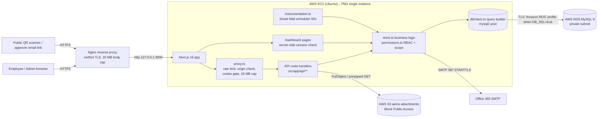
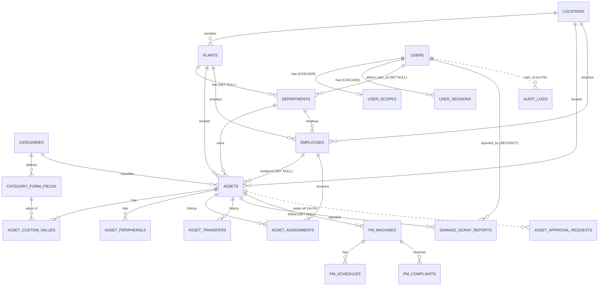
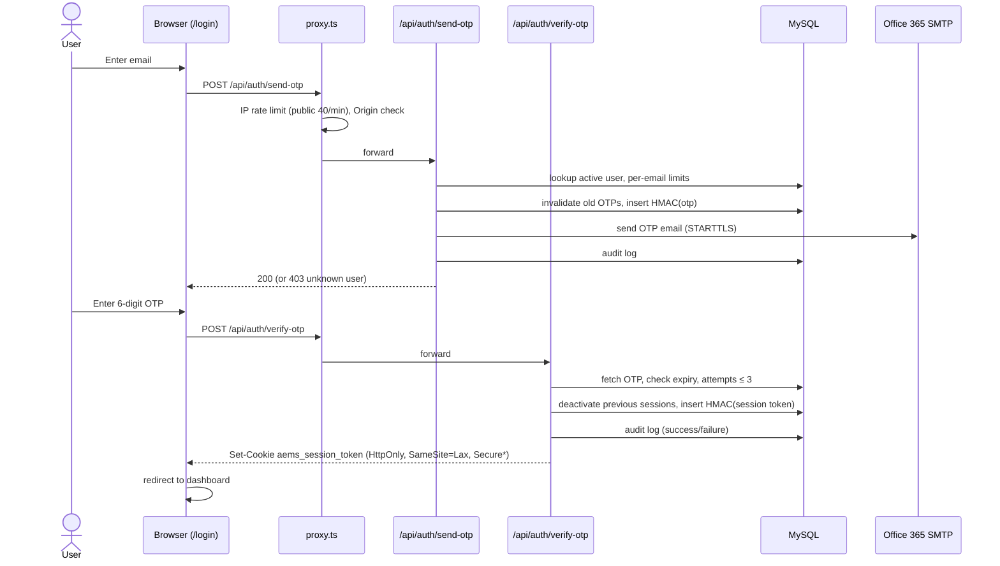
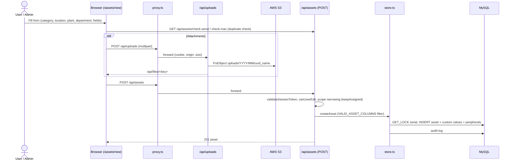
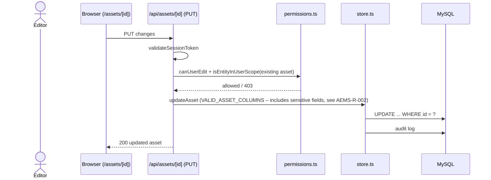
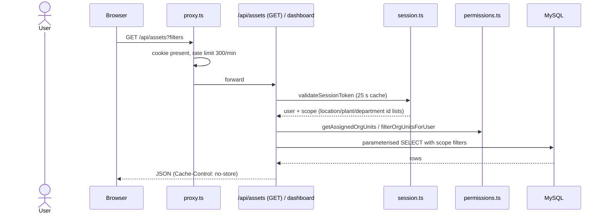

# AEMS – Complete Technical Documentation & Security Audit Assessment

> **Nature of this document:** Internal, code-level readiness assessment prepared from static inspection of the repository. It is **not** a certification, **not** a penetration test, and **not** a statement that the application is secure or compliant. Infrastructure controls (AWS, RDS, S3, Nginx, OS) were **not** inspected live and are marked "Requires manual verification" unless repository evidence exists.

---

## 1. Document Control and Overview

| Field | Value |
|---|---|
| Document title | AEMS – Technical Documentation & Security Audit Assessment |
| Application | AEMS – Asset Entry Management System (PG Electroplast Ltd) |
| Assessment date | 8 October 2026 |
| Assessment type | Static source-code, configuration and schema review (documentation-only) |
| Repository | `https://github.com/Kushagrash14/Final-aems-.git` |
| Inspected branch / commit | `vikas-security-scope-updates` at commit `73d1d4e`, **plus uncommitted working-tree changes** (multi-department admin scope, `ScopeMultiSelect` component, Supabase migration script) |
| Inspected scope | `src/**`, `aws/**`, `scripts/**`, `next.config.ts`, `package.json`, `package-lock.json`, `eslint.config.mjs`, `docs/`, `.gitignore` |
| Explicitly excluded | `.env*` secret files (not read), live AWS accounts, live database, production server, git history for credentials |
| Prepared by | AI-assisted review (Senior Architect / AppSec / DB Security / IT Audit perspective) |
| Intended audience | IT management, internal audit, system administrators, developers |
| Classification | Internal – Confidential |

### 1.1 Status vocabulary used throughout

| Status | Meaning |
|---|---|
| **Verified** | Implemented and verified in inspected source/config |
| **Partial** | Partially implemented, or implemented with identified gaps |
| **Configured – Not Verified** | Present in config/docs but runtime/infra state not verified |
| **Not Found** | Not found **in the inspected scope** (may exist outside the repository) |
| **Requires Manual Verification** | Must be confirmed by an administrator in the live environment |

### 1.2 Application purpose

AEMS is an internal web application used to register, track, assign, transfer, maintain and retire IT and plant assets across PG Electroplast locations and plants. Core capabilities verified in source:

- Asset register with category-specific custom fields, peripherals, serial/MAC duplicate checks and soft delete
- Employee master and asset assignment / de-assignment / transfer history
- Damage / missing / scrap reporting with admin review
- Preventive maintenance (PM) machines, schedules and public QR-based complaint reporting
- Asset QR stickers (public QR detail page / PDF)
- Duplicate-asset approval workflow via emailed one-time tokens
- Bulk Excel import (IT Admin)
- Smart Mail (templated campaigns with a 60-second scheduler)
- Audit log with CSV export
- Passwordless email-OTP login with role and organisational-scope based access

---

## 2. Technology Stack and Architecture

### 2.1 Technology stack (versions from `package-lock.json`)

| Layer | Technology | Version | Evidence |
|---|---|---|---|
| Runtime | Node.js | 22 (deploy guide); 24.18.1 used locally | `aws/DEPLOY.md` |
| Framework | Next.js (App Router, route handlers, `src/proxy.ts`) | 16.4.0 | `package-lock.json` |
| UI | React / React-DOM | 19.2.8 | `package-lock.json` |
| Language | TypeScript | 5.9.3 | `package-lock.json` |
| Styling | Tailwind CSS | 4.3.3 | `package-lock.json` |
| Database driver | mysql2 (pool) | 3.24.4 | `src/lib/db/mysql.ts` |
| Database | MySQL 8.0 / 8.4 on AWS RDS (documented) | — | `aws/DEPLOY.md`, `aws/mysql_schema.sql` |
| Object storage | AWS S3 via `@aws-sdk/client-s3` + `s3-request-presigner` | 3.1133.0 | `src/lib/storage/s3.ts` |
| Email | nodemailer → Office 365 SMTP (STARTTLS, TLS ≥ 1.2) | 10.0.10 | `src/lib/mailer.ts` |
| QR | qrcode | 1.5.4 | QR routes |
| Charts | recharts | 3.10.1 | dashboard |
| Excel | xlsx (SheetJS CDN tarball) | 0.20.3 | bulk import |
| Icons | lucide-react | 1.44.0 | UI |
| Lint | eslint / eslint-config-next | 9.39.5 / 16.4.0 | `eslint.config.mjs` |
| Process manager | PM2 (single fork instance) | — | `aws/ecosystem.config.cjs` |
| Reverse proxy | Nginx + certbot | — | `aws/nginx-aems.conf` |

### 2.2 Architecture overview

- **Monolith:** a single Next.js application serves both UI pages and REST-style JSON API routes (`src/app/api/**/route.ts`, 40 route files).
- **Edge gate:** `src/proxy.ts` (Next.js proxy, matcher `/api/:path*`) applies rate limits, body-size cap, cross-origin blocking and a session-cookie presence check before route handlers run.
- **Page gate:** `src/app/(dashboard)/layout.tsx` validates the session server-side (`validateSessionToken`) and redirects to `/login` if invalid.
- **Data access:** a custom Supabase-style query builder (`src/lib/db/client.ts`) over a mysql2 pool (`src/lib/db/mysql.ts`); business logic in `src/lib/store.ts`.
- **Files:** uploaded to private S3 under `uploads/YYYY/MM/<uuid>_<name>`; served via `/api/files/[...key]` as a 300-second presigned redirect.
- **Background job:** `src/instrumentation.ts` starts a 60-second `setInterval` that runs `processDueCampaigns()` (Smart Mail).
- **Mock mode:** `AEMS_MOCK_MODE=true` runs with in-memory data persisted to `.aems-demo-data.json`; refused when `NODE_ENV=production` (`src/lib/env.ts`).

### 2.3 Repository directory structure (summary)

| Path | Purpose |
|---|---|
| `src/app/login` | OTP login page |
| `src/app/(dashboard)/*` | Authenticated pages: dashboard, assets, assets/new, assets/[id], employees, staff-directory, users, settings, categories, bulk-import, audit-logs, damaged-scrap, maintenance, maintenance/complaints |
| `src/app/approval/[token]`, `src/app/qr/report/[token]` | Public token-based pages |
| `src/app/api/**` | 40 API route handlers |
| `src/proxy.ts` | API gate (rate limit, CSRF origin check, cookie gate) |
| `src/instrumentation.ts` | Smart Mail scheduler bootstrap |
| `src/lib/auth/*` | OTP, session, RBAC re-exports |
| `src/lib/permissions.ts` | Role and scope rules |
| `src/lib/db/*` | MySQL pool, query builder |
| `src/lib/store.ts` | Business/data layer |
| `src/lib/audit.ts` | Audit logging and CSV export |
| `src/lib/storage/s3.ts`, `src/lib/uploadClient.ts` | File storage |
| `src/lib/mailer.ts`, `src/lib/smartMail.ts` | Email |
| `src/lib/rateLimit.ts`, `src/lib/apiErrors.ts`, `src/lib/publicUrl.ts`, `src/lib/qrToken.ts` | Cross-cutting utilities |
| `src/components/**` | UI components (incl. `settings/ScopeMultiSelect.tsx`) |
| `aws/` | `mysql_schema.sql`, `DEPLOY.md`, `env.example`, `nginx-aems.conf`, `ecosystem.config.cjs` |
| `scripts/` | `migrate-from-supabase.mjs`, `env.migration.example` |
| `docs/AEMS-Security-Controls.md` | Pre-existing security notes |

---

## 3. Database Architecture

### 3.1 General characteristics (source: `aws/mysql_schema.sql`, `src/lib/db/*`)

| Property | Value | Status |
|---|---|---|
| Engine | MySQL 8.x, InnoDB, `utf8mb4` | Verified (schema) |
| Primary keys | `CHAR(36)` UUIDs | Verified |
| Timestamps | `DATETIME(3)`, stored as UTC (pool `timezone: 'Z'`) | Verified |
| Number of tables | 23 | Verified |
| Row-level security | Not available natively in MySQL; enforced in application code (`permissions.ts`, route filters) | Verified (design) |
| Migration tooling | None (single SQL file + runtime `CREATE TABLE IF NOT EXISTS` for `smart_mail_campaigns`, `asset_approval_requests`) | Verified |
| Soft delete | `assets.is_deleted`, `deleted_at`, `deleted_by` | Verified |
| DB user privilege | `aems_app` with SELECT/INSERT/UPDATE/DELETE only (documented) | Configured – Not Verified |
| Encryption at rest / backups | Not in repository | Requires Manual Verification |

### 3.2 Table inventory

| Table | Purpose | PK | Relationships | Sensitive Data | Access Controls | Evidence |
|---|---|---|---|---|---|---|
| `locations` | Geographic sites (e.g. Pune) | id | ← plants, employees, assets, pm_machines | Low | Read scoped; write IT Admin | schema; `api/locations` |
| `plants` | Plants under a location (NGM, PGTL, PGEL) | id | → locations (RESTRICT) | Low | Read scoped; write IT Admin | schema; `api/plants` |
| `users` | System accounts, role, legacy single scope ids | id | ← sessions, scopes; no FK on location/plant/department | **PII** (name, email), role | IT Admin; Admin for in-scope `user` role | schema; `api/users` |
| `departments` | Departments, optional plant and admin | id | → plants (SET NULL), → users.admin_user_id (SET NULL) | Low | Read scoped; write IT Admin | `api/settings/departments` |
| `user_scopes` | Multi-unit scope lists and `can_edit` | id (unique user_id) | → users (CASCADE) | Authorisation data | IT Admin / Admin within scope | `store.ts`, `api/users` |
| `auth_otps` | Hashed OTP codes, attempts, expiry | id | by email | **Credential material (hashed)** | Server only | `src/lib/auth/otp.ts` |
| `user_sessions` | Hashed session tokens, activity, IP/UA | id | → users (CASCADE) | **Session credential (hashed)**, IP | Server only | `src/lib/auth/session.ts` |
| `categories` | Asset categories | id | ← form fields, assets | Low | Write IT Admin/Admin/HR (see findings) | `api/categories` |
| `category_form_fields` | Dynamic per-category fields | id | → categories (CASCADE) | Low | Write – see AEMS-R-005 | `api/categories/[id]/fields` |
| `employees` | Employee master | id | → departments, plants, locations (RESTRICT) | **PII** (name, code, email, phone, designation) | Read scoped; write – see AEMS-R-004 | `api/employees` |
| `assets` | Asset register | id | → categories/locations/plants/departments (RESTRICT); → employees (SET NULL); → users (SET NULL) | Serial, MAC, hostname, invoice data, attachments | Scoped read/write; delete IT Admin/Admin | `api/assets*` |
| `asset_custom_values` | Values for dynamic fields | id | → assets, fields (CASCADE) | Varies | Through asset | `store.ts` |
| `asset_peripherals` | Peripherals per asset | id | → assets (CASCADE) | Serials | Through asset | `store.ts` |
| `asset_assignments` | Assignment history | id | → assets (CASCADE), employees (RESTRICT), users (SET NULL) | PII linkage | Scoped | `api/assets/assign` |
| `asset_transfers` | Transfer history | id | → assets (CASCADE), to_* (RESTRICT), from_* (SET NULL) | Low | Scoped – see AEMS-R-007 | `api/assets/transfer` |
| `damage_scrap_reports` | Damage/missing/scrap reports and review | id | → assets (CASCADE), users (RESTRICT / SET NULL) | Remarks, photos | Report: editors; review: Admin/IT Admin | `api/damaged-scrap` |
| `pm_machines` | PM machine master with QR token | id | → assets (SET NULL), plant/location/department (RESTRICT) | `qr_code_token` | Scoped | `api/pm/machines` |
| `pm_schedules` | PM schedules | id | → pm_machines (CASCADE), users (SET NULL) | Low | Scoped | `api/pm/machines` |
| `pm_complaints` | Complaints (public QR + internal) | id | → pm_machines (CASCADE), users (SET NULL) | Reporter name/contact | Public POST; PATCH – see AEMS-R-009 | `api/pm/complaint` |
| `audit_logs` | Security / activity audit trail | id | user_id (no FK, intentional) | IP, UA, emails, action details | Read: Admin/IT Admin (not scoped – AEMS-R-006) | `src/lib/audit.ts`, `api/audit` |
| `email_templates` | OTP / notification templates | id | — | Low | IT Admin | schema seed |
| `smart_mail_campaigns` | Smart Mail drafts / schedules | id | No FK | Recipient lists | IT Admin | `api/smart-mail` |
| `asset_approval_requests` | Duplicate-asset approval tokens | id (unique token) | No FK | Token, asset/employee snapshot | Token holder (public) | `api/asset-approvals`, `api/public/asset-approval/[token]` |

### 3.3 Entity-relationship diagram (core entities)

Standalone tables without FKs: `auth_otps` (keyed by email), `email_templates`, `smart_mail_campaigns`.

### 3.4 Constraints summary

- **Unique keys (verified):** `locations.name`, `locations.code`; `plants(location_id, code)`; `users.email`; `departments.code`; `user_scopes.user_id`; `categories.name`, `categories.code`; `category_form_fields(category_id, field_name)`; `employees.emp_code`; `assets.asset_tag`; `asset_custom_values(asset_id, field_id)`; `pm_machines.machine_code`, `pm_machines.qr_code_token`; `email_templates.template_key`; `asset_approval_requests.token`.
- **ENUMs (verified):** `users.role` ∈ {it_admin, admin, hr, user}; `assets.status` ∈ {in_service, maintenance, damaged, missing, scrapped, in_storage}; `employees.status` ∈ {active, resigned, on_leave}; field types; report types {damaged, missing, scrap}; severity {minor, major, total_loss}; PM/complaint status and priority; `audit_logs.risk_level`.
- **Missing FKs (observation):** `users.location_id/plant_id/department_id` have no FK; orphaned references are possible.

---

## 4. Database Security Assessment

| Control | Expected Protection | Evidence | Status | Risk | Recommendation |
|---|---|---|---|---|---|
| SQL injection prevention | All values parameterised; identifiers validated | `src/lib/db/client.ts` – `IDENT` regex `^[A-Za-z_][A-Za-z0-9_]*$`, `q()` quoting, `?` placeholders | Verified | Low | Keep; add unit tests for the builder |
| Unbounded UPDATE/DELETE protection | Refuse writes without WHERE | `client.ts` (~L584) | Verified | Low | Keep |
| Least-privilege DB account | App user without DDL/GRANT | `aws/DEPLOY.md` (`aems_app` SELECT/INSERT/UPDATE/DELETE) | Configured – Not Verified | Medium | Confirm `SHOW GRANTS` on RDS. Note runtime `CREATE TABLE IF NOT EXISTS` needs CREATE privilege or pre-created tables |
| Transport encryption to DB | TLS to RDS | `mysql.ts` – `ssl: env.db.ssl ? 'Amazon RDS' : undefined` | Partial | Medium | Enforce `DB_SSL=true` in production and `require_secure_transport=ON` on RDS |
| Network isolation | RDS private, SG allows EC2 only | `aws/DEPLOY.md` | Configured – Not Verified | High if exposed | Verify RDS "Publicly accessible = No" and SG rules |
| Encryption at rest | RDS KMS encryption | Not in repo | Requires Manual Verification | Medium | Confirm in RDS console |
| Credential storage | Secrets outside code | `aws/env.example` placeholders; `.gitignore` ignores `.env*` | Partial | Medium | Move to AWS Secrets Manager / SSM; rotate. `env.ts` has dev-only fallback secret (refused in production) |
| Hashed authentication secrets | OTP and session tokens not stored in clear | `otp.ts`, `session.ts` – HMAC-SHA256 with `SESSION_SECRET` | Verified | Low | Keep; plan secret rotation procedure |
| Referential integrity | FKs on business relations | `mysql_schema.sql` | Partial | Low | Add FKs on `users` org columns |
| Audit table immutability | No app path updates/deletes audit rows | Code search: no UPDATE/DELETE on `audit_logs` | Partial (app-level only) | Medium | Revoke UPDATE/DELETE on `audit_logs` for `aems_app` or ship logs off-host |
| Row-level isolation | Plant/location/department filtering | `permissions.ts` `isEntityInUserScope`, `filterOrgUnitsForUser`; route filters | Partial | High | See risks AEMS-R-001/004/006/007/009 |
| Mass-assignment protection | Writable column allow-list | `store.ts` `VALID_ASSET_COLUMNS` includes `is_deleted`, `status`, `created_by` | Partial | High | Split create/update allow-lists (AEMS-R-002) |
| Backups / PITR | Automated backups, retention | Not in repo | Requires Manual Verification | High | Confirm RDS automated backups, retention, restore test |
| Schema change control | Versioned migrations | Single SQL file + runtime DDL | Not Found | Medium | Adopt versioned migrations |
| Serial-number race protection | Lock on duplicate check | `mysql.ts` lock pool `GET_LOCK` | Verified | Low | Keep |
| Error leakage | DB errors not shown to clients | `src/lib/apiErrors.ts` `safeErrorMessage` | Partial | Low | Exceptions: public PM complaint 429 text, test-smtp |

---

## 5. Authentication and Session Security

### 5.1 Mechanism

Passwordless **email OTP**. No passwords are stored. The OTP is the single authentication factor; possession of the mailbox equals account access.

| Aspect | Implementation | Evidence | Status |
|---|---|---|---|
| OTP generation | 6 digits from `crypto.randomInt` | `src/lib/auth/otp.ts` | Verified |
| OTP storage | HMAC-SHA256(`SESSION_SECRET`, `email:otp`) | `otp.ts` | Verified |
| OTP expiry | 10 minutes; previous unused OTPs invalidated | `otp.ts` | Verified |
| OTP attempts | 3 per OTP | `api/auth/verify-otp` | Verified |
| OTP comparison | Hash string compared with `!==` (not constant-time) | `verify-otp` | Partial (low risk – hashed values) |
| Per-email send limit | 60 s cooldown, 5 per 15 min (DB-backed); **fails open on DB error** | `otp.ts` (~L56-58) | Partial |
| Per-IP send limit | 20 / 15 min (in-memory) | `api/auth/send-otp` | Verified (per process) |
| Verify limits | 30 / 15 min per IP; 10 failures / 30 min per email lockout (in-memory) | `verify-otp` | Verified (per process) |
| User enumeration | Unknown email → 403, known → 200 | `send-otp` (~L68-81) | Partial – enumeration possible |
| OTP email transport | SMTP STARTTLS on 587, `minVersion TLSv1.2` | `mailer.ts` L21-32 | Verified |

### 5.2 Session management

| Aspect | Implementation | Evidence | Status |
|---|---|---|---|
| Token | 256-bit random; only HMAC hash stored in `user_sessions` | `session.ts` | Verified |
| Concurrent sessions | Single active session – prior sessions deactivated at login | `session.ts` | Verified |
| Idle timeout | 24 h for all roles | `permissions.ts` `getInactivityTimeoutSeconds` | Verified |
| Absolute lifetime | 7 days | `session.ts` | Verified |
| Validation cache | 25 s in-process cache (deactivation may lag up to 25 s where not invalidated) | `session.ts` | Verified |
| Cookie | `aems_session_token`; `httpOnly`; `secure = env.cookieSecure` (defaults on for https app URL); `SameSite=Lax`; maxAge 24 h | `session.ts`, `session-constants.ts`, `env.ts` | Verified (code); production value Requires Manual Verification |
| Logout | `terminateSession` sets `is_active=false`; cookie cleared (without full attributes) | `api/auth/logout` | Verified |
| Client idle tracker | `IdleSessionTracker` in dashboard layout | `(dashboard)/layout.tsx` | Verified |
| Page protection | Server-side `validateSessionToken`, redirect `/login` | `(dashboard)/layout.tsx` L15-21 | Verified |
| API protection | Proxy cookie-presence gate + per-route `validateSessionToken` | `src/proxy.ts`, route handlers | Verified |
| MFA | Not implemented (OTP is single factor) | — | Not Found |
| CSRF | SameSite=Lax + proxy Origin check on state-changing methods (requests without `Origin` allowed) | `src/proxy.ts` | Partial |

---

## 6. Authorization and RBAC

### 6.1 Roles

| Role | Description | Scoped? |
|---|---|---|
| `it_admin` | Full system administration. The **Primary IT Admin** (fixed email in `permissions.ts` `PRIMARY_IT_ADMIN_EMAIL`) is the only account that can grant/revoke IT Admin and cannot be deleted. | No (global) |
| `admin` | Manages assets, employees and standard users within assigned locations / plants / departments (multi-unit via `user_scopes`) | Yes (`isScopedRole`) |
| `hr` | HR access; **not** a scoped role – falls back to legacy single-id filtering and sees everything if no unit assigned | Partial |
| `user` | Standard user; may create/edit assets within scope if `can_edit`; cannot delete | Yes |

There are no separate "Plant Admin" or "Location Admin" roles; these are expressed as an `admin` with a restricted scope. Category scoping (`scope.category_ids`) exists in the type but is set to `null` in `resolveUserOrgUnits` (`session.ts` ~L139-151) and therefore **not enforced**.

### 6.2 Role-permission matrix (as implemented)

| Capability | Primary IT Admin | IT Admin | Admin (scoped) | HR | User (scoped) | Evidence |
|---|---|---|---|---|---|---|
| View assets | All | All | Own scope | Legacy filter / all | Own scope | `isEntityInUserScope` |
| Create / edit assets | Yes | Yes | Scope + `can_edit` | `can_edit` | Scope + `can_edit` | `api/assets`, `canUserEdit` |
| Delete (soft) assets | Yes | Yes | If `can_edit` | No | No | `canDeleteAsset` |
| Assign / de-assign / transfer | Yes | Yes | Scope (gaps – AEMS-R-007) | `can_edit` | `can_edit` | `api/assets/assign|deassign|transfer` |
| Bulk Excel import (`/api/bulk-import`) | Yes | Yes | No | No | No | `canPerformBulkImport` |
| Asset import (`/api/assets/import`) | Yes | Yes | **Yes, unscoped** (AEMS-R-008) | — | No | route |
| Manage employees (write) | Yes | Yes | Yes (writes not scope-enforced – AEMS-R-004) | Yes | No | `api/employees` (blocks `user` role) |
| Create users | Any role | Any except IT Admin | `user` role only, own scope | No | No | `canCreateUsers`, `canAssignRole` |
| Edit/delete IT Admin accounts | Yes | No | No | No | No | `canManageUserAccount` |
| Settings – user management | Yes | Yes | Yes | No | No | `canAccessSettings` |
| Settings – master data, entry forms, security audit | Yes | Yes | No | No | No | `canAccessAdvancedSettings` |
| Categories CRUD | Yes | Yes | Yes (global effect – AEMS-R-012) | POST only | No | `api/categories` |
| Category form fields POST | Yes | Yes | Yes | Yes | **Yes if can_edit** (AEMS-R-005) | `api/categories/[id]/fields` |
| Review damage/scrap | Yes | Yes | If `can_edit` | No | No | `canReviewDamageScrap` |
| View audit log | Yes | Yes | **All plants** (AEMS-R-006) | No | No | `api/audit` |
| Smart Mail | Yes | Yes | No | No | No | `api/smart-mail` |
| Generate asset QR token | Yes | Yes | **Any asset** (AEMS-R-001) | Any | Any | `api/assets/[id]/qr-token` |

---

## 7. Security Audit Checklist (40 controls)

Legend – Status: Verified / Partial / Not Found / Not Verified. Retest status for all items: **Open – pending retest** unless marked otherwise.

| ID | Control | Expected | Actual | Evidence | Status | Risk | Observation | Corrective Action | Retest |
|---|---|---|---|---|---|---|---|---|---|
| AC-01 | Authentication required for app pages | Server-side check | `validateSessionToken` + redirect | `(dashboard)/layout.tsx` | Verified | Low | — | — | N/A |
| AC-02 | Authentication required for APIs | Every non-public route | Proxy cookie gate + per-route validation | `src/proxy.ts`, routes | Verified | Low | Public list is explicit | Keep list minimal | N/A |
| AC-03 | Password policy / storage | Strong hashing | No passwords (OTP only) | `otp.ts` | Verified | Low | N/A by design | — | N/A |
| AC-04 | OTP randomness & storage | CSPRNG, hashed | `randomInt`, HMAC | `otp.ts` | Verified | Low | — | — | N/A |
| AC-05 | OTP brute-force protection | Attempts + rate limit | 3 attempts, IP/email limits | `verify-otp` | Partial | Medium | In-memory, per process; email-lockout can be abused for DoS | Persist limits in DB/Redis; CAPTCHA after failures | Open |
| AC-06 | User enumeration resistance | Uniform responses | 200 vs 403 | `send-otp` | Partial | Medium | Reveals registered emails | Uniform response | Open |
| AC-07 | MFA for privileged roles | 2nd factor for admins | Not present | — | Not Found | Medium | Mailbox compromise = admin access | Consider TOTP/SSO for IT Admin | Open |
| AC-08 | Session token entropy & storage | ≥128-bit, hashed | 256-bit, HMAC | `session.ts` | Verified | Low | — | — | N/A |
| AC-09 | Session timeouts | Idle + absolute | 24 h idle, 7 d absolute | `session.ts`, `permissions.ts` | Verified | Low | 24 h idle is long for admins | Consider shorter admin idle | Open |
| AC-10 | Cookie flags | HttpOnly, Secure, SameSite | All present; Secure via config | `session.ts`, `env.ts` | Partial | Medium | Secure depends on env | Verify `SESSION_COOKIE_SECURE`/https URL in prod | Not Verified |
| AC-11 | Logout invalidates server session | Yes | `is_active=false` | `logout` | Verified | Low | — | — | N/A |
| AC-12 | Single active session | Optional | Enforced | `session.ts` | Verified | Low | — | — | N/A |
| AZ-01 | Server-side RBAC | Central helpers | `permissions.ts` | `permissions.ts` | Verified | Low | — | — | N/A |
| AZ-02 | Cross-plant isolation – asset read | Filter by scope | `isEntityInUserScope` | `api/assets` | Verified | Low | — | — | N/A |
| AZ-03 | Cross-plant isolation – QR token | Scope check | None | `api/assets/[id]/qr-token` | Partial | High | IDOR + PII disclosure | Add existence + scope check | Open |
| AZ-04 | Cross-plant isolation – employees write | Scope check | Role/can_edit only | `api/employees` | Partial | High | IDOR | Scope check on POST/PUT/DELETE | Open |
| AZ-05 | Cross-plant isolation – audit log | Scope filter for admins | Unscoped | `api/audit` | Partial | High | Admins see all plants | Filter or restrict to IT Admin | Open |
| AZ-06 | Mass assignment | Field allow-list per action | Allow-list includes sensitive fields | `store.ts` `VALID_ASSET_COLUMNS` | Partial | High | Bypass of delete/scrap workflow | Remove sensitive fields from client-writable list | Open |
| AZ-07 | Global config changes restricted | IT Admin only | Fields POST open to any editor; Admin edits categories | `api/categories/**` | Partial | High | — | Restrict to IT Admin | Open |
| AZ-08 | Privilege escalation protection | Role assignment rules | `canAssignRole`, Primary IT Admin | `permissions.ts` | Verified | Low | — | — | N/A |
| AZ-09 | Account-takeover protection on user edit | Email change restricted | Admin can change in-scope user email | `api/users` PATCH | Partial | Medium | Takeover via OTP to new email | Restrict email change to IT Admin | Open |
| AZ-10 | Approval workflow segregation | Independent approver | Requester chooses approvers | `api/asset-approvals` | Partial | High | Self-approval possible | Server-defined approvers | Open |
| IV-01 | SQL injection | Parameterised | Yes | `db/client.ts` | Verified | Low | — | — | N/A |
| IV-02 | XSS | No raw HTML sinks | No `dangerouslySetInnerHTML`/`eval`; React escaping | code search | Verified | Low | Smart Mail HTML sanitizer only strips `<script>` (email context) | Use a proper HTML sanitizer | Open |
| IV-03 | Input validation (enums, formats, lengths) | Whitelists | Partial (role, report type, email format gaps) | users, damaged-scrap routes | Partial | Low | — | Add schema validation (e.g., zod) | Open |
| IV-04 | CSV/formula injection | Neutralise `= + - @` | Not neutralised | `audit.ts` `escapeCsv` | Partial | Medium | — | Prefix with `'` | Open |
| FU-01 | Upload size limit | Enforced | 10 MB route; 25 MB proxy header; 20 MB Nginx | `api/uploads`, `proxy.ts`, nginx | Verified | Low | Proxy cap header-only | — | N/A |
| FU-02 | Upload type validation | Server-side content check | Client MIME allow-list only | `api/uploads` | Partial | Medium | — | Magic-byte check | Open |
| FU-03 | Private file storage | Not public | S3 private + 300 s presigned | `s3.ts`, `api/files` | Verified (code) | Low | Bucket policy not verified | Verify Block Public Access | Not Verified |
| FU-04 | File path traversal | Prefix + `..` check | Yes | `api/files/[...key]` | Verified | Low | No per-file ownership | Consider ownership mapping | Open |
| EH-01 | Safe error messages | No internals | `safeErrorMessage` | `apiErrors.ts` | Partial | Low | Exceptions in PM complaint, test-smtp | Mask remaining | Open |
| HD-01 | Security headers | CSP, HSTS, XFO, nosniff | All present | `next.config.ts` | Verified | Low | CSP uses `'unsafe-inline'` | Nonce-based CSP | Open |
| CS-01 | CSRF protection | Origin/token | SameSite Lax + Origin check | `proxy.ts` | Partial | Low | No-Origin requests allowed | Require Origin/Sec-Fetch-Site | Open |
| RL-01 | Rate limiting | Global & per-endpoint | In-memory per process | `rateLimit.ts`, `proxy.ts` | Partial | Medium | Resets on restart; single instance only | Shared store | Open |
| LG-01 | Audit logging of security events | Login, failures, changes | Yes for most; uploads, test-smtp, damage PUT not logged | `audit.ts`, routes | Partial | Medium | Store-level entries hardcode role `admin`, no IP | Fix actor attribution | Open |
| LG-02 | Audit log integrity | Append-only | No app update/delete path | code search | Partial | Medium | DB grants allow delete | DB-level protection | Open |
| CF-01 | Secrets management | Vault, no defaults | env vars; dev fallbacks refused in prod | `env.ts`, `env.example` | Partial | Medium | — | Secrets Manager | Not Verified |
| CF-02 | Mock/demo mode disabled in prod | Refused | Refused when `NODE_ENV=production` | `env.ts` L56-58 | Verified | Low | — | — | N/A |
| DP-01 | Dependency vulnerabilities | No known vulns | `npm audit --omit=dev`: 0; full: 5 high in dev-only lint chain | `npm audit` 8 Oct 2026 | Partial | Low | Dev tooling only | Update `eslint-config-next` chain | Open |
| BK-01 | Backup & restore | Automated, tested | Not in repo | — | Not Verified | High | — | Confirm RDS backups, S3 versioning, restore test | Not Verified |

---

## 8. Data Flow

### 8.1 Login (email OTP)

### 8.2 Asset entry

### 8.3 Asset update

### 8.4 Data retrieval (list / dashboard)

---

## 9. Standard Operating Procedures

### 9.1 User SOP

| Step | Action | Expected Result | Validation | Common Issue | Resolution |
|---|---|---|---|---|---|
| 1 | Open the AEMS URL and enter company email | "OTP sent" message | Email received within ~1 min | "Not registered" / 403 | Ask Admin/IT Admin to create the account |
| 2 | Enter the 6-digit OTP within 10 minutes | Dashboard opens | User name shown in navbar | "Invalid/expired OTP" | Request a new OTP after 60 s; max 3 attempts per OTP |
| 3 | Search or browse assets | Only assets in your scope appear | Location/plant filters limited to yours | Asset missing | Confirm scope with Admin |
| 4 | Register a new asset (Assets → New) | Asset saved with tag | Appears in list; duplicate serial warned | "No edit permission" | Request `can_edit` from Admin |
| 5 | Attach invoice/photo | File uploads | Link opens file | File rejected | Use allowed type ≤ 10 MB |
| 6 | Report damage / missing / scrap | Report in pending review | Visible in Damaged/Scrap page | — | Admin reviews |
| 7 | Log out when done | Returned to login | Session ends | Auto-logout after 24 h idle | Log in again |

### 9.2 Admin SOP

| Step | Action | Expected Result | Validation | Common Issue | Resolution |
|---|---|---|---|---|---|
| 1 | Log in with OTP | Dashboard with admin menus | Settings → User Management visible | Advanced tabs hidden | Expected – IT Admin only |
| 2 | Create a standard user (Settings → Register User) | User created with assigned locations/plants/departments (multi-select) | User appears in list with department names | Cannot pick other units | Admin can only assign units within own scope |
| 3 | Grant / revoke edit rights | `can_edit` updated | User sees/does not see edit actions | Partial edit resets scope | Re-select all scope fields on every edit (see AEMS-R-010) |
| 4 | Assign / de-assign / transfer assets | History rows created | Asset detail shows history | Destination outside scope accepted | Verify destination manually until AEMS-R-007 fixed |
| 5 | Review damage / scrap reports | Status approved/rejected | Asset status updated | — | — |
| 6 | Review audit log | Events listed | Export CSV | CSV opens with formulas | Open CSV as text until AEMS-R-006 fixed |
| 7 | IT Admin: master data, categories, form fields | Changes apply globally | New fields in asset form | — | Change via IT Admin only (recommended) |
| 8 | IT Admin: bulk import | Rows imported | Import summary | Unmatched names fall back to first master value | Validate master names before import |
| 9 | IT Admin: deactivate leavers | User cannot log in | Login fails | Session active up to 25 s | Acceptable; or restart |
| 10 | Primary IT Admin: grant/revoke IT Admin | Role updated | — | Other IT Admins blocked | By design |

---

## 10. API Reference

All routes are under `/api`. Authentication = session cookie validated by `validateSessionToken` unless marked **Public**. Responses are JSON with `Cache-Control: no-store` (set by proxy). Request/response examples are intentionally omitted; consult route source for payload shapes.

| Route | Methods | Access | Purpose | Key Controls / Notes |
|---|---|---|---|---|
| `auth/send-otp` | POST | Public | Send login OTP | IP + email limits; enumeration (AEMS-R-011) |
| `auth/verify-otp` | POST | Public | Verify OTP, create session | Attempts, lockout |
| `auth/logout` | POST | Public (cookie) | End session | — |
| `auth/me` | GET | Public (cookie) | Current user + scope | — |
| `auth/heartbeat` | POST | Public (cookie) | Activity refresh | — |
| `auth/test-smtp` | GET/POST | IT Admin | SMTP test | Raw errors; not audited |
| `users` | GET/POST/PATCH/DELETE | IT Admin, Admin (scoped) | User management | `canAssignRole`, `canManageUserAccount` |
| `employees` | GET/POST/PUT/DELETE | Non-`user` roles | Employee master | Writes not scope-checked (AEMS-R-004) |
| `locations` (GET/POST), `locations/[id]` (PATCH/DELETE) | GET/POST/PATCH/DELETE | Read scoped; write IT Admin | Locations | — |
| `plants`, `plants/[id]` | GET/POST/PATCH/DELETE | Read scoped; write IT Admin | Plants | — |
| `settings/departments` | GET/POST/PATCH/DELETE | Read scoped; write IT Admin | Departments | — |
| `lookups` | GET | Authenticated | Dropdown data | Scope filtered |
| `categories` | GET/POST/PATCH/DELETE | Authenticated; writes Admin/IT Admin (POST also HR) | Categories | AEMS-R-012 |
| `categories/[id]/fields` | GET/POST/PATCH/DELETE | Authenticated; PATCH IT Admin; DELETE Admin/IT Admin | Dynamic fields | POST lacks role check – only `canUserEdit` (AEMS-R-005) |
| `assets` | GET/POST | Authenticated, scoped | List / create | Scope filter; `keepAssigned` |
| `assets/[id]` | GET/PUT/DELETE | Scoped | Detail / update / soft delete | Mass assignment (AEMS-R-002) |
| `assets/[id]/qr-token` | GET | Authenticated | Generate QR token | No scope check (AEMS-R-001) |
| `assets/assign`, `assets/deassign`, `assets/transfer` | POST | Editors | Assignment lifecycle | Department/destination gaps (AEMS-R-007) |
| `assets/import` | POST | IT Admin, Admin | Import | Unscoped for admin (AEMS-R-008) |
| `assets/repair-categories` | GET/POST | IT Admin | Category data repair | Audited |
| `assets/check-serial`, `assets/check-mac` | GET | Authenticated | Duplicate checks | Cross-scope lookup (low) |
| `bulk-import` | POST | IT Admin | Excel import | Fallback to first master (low) |
| `asset-approvals` (POST), `asset-approvals/[id]` (GET) | POST / GET | Authenticated | Duplicate-asset approval requests | Requester-chosen approvers (AEMS-R-003) |
| `public/asset-approval/[token]` | GET/POST | **Public (token)** | Approve / reject | 48-hex token, 7-day TTL, atomic update |
| `qr/asset/[token]` | GET | **Public (token)** | QR detail / PDF | Non-expiring HMAC token |
| `pm/machines` | GET | Scoped | PM machines & schedules (read) | Scope-filtered |
| `pm/token/[token]` | GET | **Public (token)** | Machine info for complaint form | — |
| `pm/complaint` | GET / POST / PATCH | POST **Public**; GET and PATCH authenticated | Raise / update complaint | PATCH IDOR (AEMS-R-009); POST not token-bound |
| `damaged-scrap` | GET/POST/PUT/PATCH | Scoped; review Admin/IT Admin | Damage/scrap workflow | Enum whitelist gaps (low) |
| `audit` | GET | Admin, IT Admin | Audit list / CSV | Unscoped (AEMS-R-006) |
| `smart-mail`, `smart-mail/send` | GET/POST/PATCH/DELETE | IT Admin | Campaigns | Script-only sanitizer |
| `uploads` | POST | Authenticated | Upload to S3 | Client MIME; no `can_edit`; not audited |
| `files/[...key]` | GET | Authenticated | Presigned redirect | Prefix/`..` check |

*Note:* HTTP methods were verified against the exported handler functions in each `route.ts` on 8 October 2026.

---

## 11. Logging, Monitoring and Audit Trail

| Aspect | Implementation | Evidence | Status |
|---|---|---|---|
| Audit storage | `audit_logs` table (memory in mock mode) | `src/lib/audit.ts` `logAuditEvent` | Verified |
| Fields | user id/email/role, action, entity, details, IP, user agent, `risk_level` | schema, `audit.ts` | Verified |
| Risk scoring | FAIL/DENIED/UNAUTHORIZED count per IP in 15 min → risk level | `audit.ts` | Verified |
| Events logged | Login success/failure, OTP sends, asset/employee/user/category/master CRUD, assignments, transfers, approvals, damage reports, imports | routes, `store.ts` | Partial |
| Events not logged | Uploads, `test-smtp`, damage-report PUT | routes | Partial |
| Attribution defects | Some store-level entries hardcode `user_role='admin'` and omit IP | `store.ts` (~L2335, L2502, L2606, L2676) | Partial |
| Logging failure handling | `console.error` only; request continues | `audit.ts` | Partial |
| Integrity | No application UPDATE/DELETE path; DB grants allow deletion | code search | Partial |
| Export | CSV export; no formula neutralisation | `audit.ts` `escapeCsv` | Partial |
| Application logs | stdout via PM2 | `ecosystem.config.cjs` | Configured – Not Verified (rotation/retention) |
| Centralised monitoring / alerting | Not found (no CloudWatch agent / SIEM config) | — | Not Found |
| AWS CloudTrail / RDS logs / S3 access logs | Not in repo | — | Requires Manual Verification |

---

## 12. Deployment and Infrastructure

| Component | Documented configuration | Evidence | Status |
|---|---|---|---|
| Compute | AWS EC2 Ubuntu, Node 22 | `aws/DEPLOY.md` | Configured – Not Verified |
| Process | PM2, 1 instance, fork mode, bound to `127.0.0.1:3000`, `NODE_ENV=production`, restart at 1 GB | `aws/ecosystem.config.cjs` | Verified (file) |
| Reverse proxy | Nginx, `client_max_body_size 20m`, `X-Forwarded-For $remote_addr` (overwrites client header), `proxy_read_timeout 120s` | `aws/nginx-aems.conf` | Verified (file) |
| TLS | certbot `--nginx` adds HTTPS (template is port 80 only) | `nginx-aems.conf` comments | Requires Manual Verification |
| HSTS | Sent by application | `next.config.ts` | Verified (code) |
| Database | RDS MySQL 8, private, SG from EC2 only | `DEPLOY.md` | Configured – Not Verified |
| Storage | S3 `aems-attachments`, ap-south-1, Block Public Access, IAM role scoped to `uploads/*` | `DEPLOY.md` | Configured – Not Verified |
| Secrets | `.env.local` on server (variables listed in `aws/env.example`) | `env.example`, `.gitignore` | Configured – Not Verified |
| Release process | `git pull && npm ci && npm run build && pm2 restart` (manual) | `DEPLOY.md` | Verified (doc) |
| CI/CD | No `.github/workflows`, no Dockerfile | repository | Not Found |
| Automated tests | No test directory / test script | repository | Not Found |
| Background scheduler | In-process 60 s interval | `src/instrumentation.ts` | Verified |

Important: the IP-based rate limiter (`getClientIp` – last `X-Forwarded-For` entry) is only reliable when the app is reachable **exclusively** through Nginx. The PM2 config binds to loopback, which supports this; confirm the EC2 security group does not expose port 3000.

---

## 13. Risk Register

Severity = Likelihood × Impact (qualitative). Responsible team defaults: **Dev** = application developers, **Infra** = IT infrastructure / cloud admin. Retest status for all: **Open**.

| Risk ID | Finding | Evidence | Component | Likelihood | Impact | Severity | Business Impact | Remediation | Responsible Team | Retest Status |
|---|---|---|---|---|---|---|---|---|---|---|
| AEMS-R-001 | QR token can be generated for any asset id without scope/existence check; public QR page/PDF exposes employee and asset details; tokens never expire and cannot be revoked | `src/app/api/assets/[id]/qr-token/route.ts`; `src/lib/qrToken.ts`; `api/qr/asset/[token]` | QR | Medium | High | **High** | Cross-plant PII / asset data disclosure | Add scope check; minimise public fields; add token versioning/revocation; separate signing key | Dev | Open |
| AEMS-R-002 | Mass assignment: client-writable asset columns include `is_deleted`, `deleted_at`, `deleted_by`, `status`, `created_by`; mock mode has no allow-list | `src/lib/store.ts` `VALID_ASSET_COLUMNS` | Assets | Medium | High | **High** | Users with edit rights can delete/scrap assets bypassing approval workflow; audit trail distortion | Separate create/update allow-lists excluding lifecycle fields | Dev | Open |
| AEMS-R-003 | Duplicate-asset approval: requester chooses approver emails; CC recipients also receive approve links; public POST has no identity check | `api/asset-approvals/route.ts`; `src/lib/mailer.ts` | Approvals | Medium | High | **High** | Self-approval defeats control | Server-side approver list (department admin/IT Admin); approve link only to designated approver | Dev | Open |
| AEMS-R-004 | Employee POST/PUT/DELETE not scope-enforced | `api/employees/route.ts` | Employees | Medium | High | **High** | Cross-plant modification of HR master data | Apply `isEntityInUserScope` on target and requested units | Dev | Open |
| AEMS-R-005 | `POST /api/categories/[id]/fields` has no role check | `api/categories/[id]/fields/route.ts` | Categories | Medium | Medium | **High** | Any editor can alter global asset forms | Restrict to IT Admin | Dev | Open |
| AEMS-R-006 | Audit log not scoped for Admin; CSV export formula injection; unauthenticated OTP requests write arbitrary email strings into the log | `api/audit/route.ts`; `src/lib/audit.ts` `escapeCsv` | Audit | Medium | Medium | **High** | Cross-plant disclosure; spreadsheet code execution risk for reviewers | Scope or IT-Admin-only; neutralise CSV formulas; length-limit logged input | Dev | Open |
| AEMS-R-007 | Assign/de-assign/transfer: department and destination scope not fully validated | `api/assets/assign|deassign|transfer` | Assets | Medium | Medium | Medium | Assets moved outside admin's scope | Validate destination ids and scope | Dev | Open |
| AEMS-R-008 | `/api/assets/import` allows Admin import into any location/plant | `api/assets/import/route.ts` | Import | Low | Medium | Medium | Cross-plant data pollution | Enforce scope or restrict to IT Admin | Dev | Open |
| AEMS-R-009 | `PATCH /api/pm/complaint` lacks scope/existence check; public POST not token-bound and leaks raw DB error with 429 | `api/pm/complaint/route.ts`; `store.ts` (~L2838) | PM | Medium | Medium | Medium | Cross-plant changes; spam complaints | Scope check; bind POST to machine token; mask errors | Dev | Open |
| AEMS-R-010 | Users PATCH: role not whitelisted; Admin can change managed user's email (OTP takeover); partial PATCH resets scope/`can_edit`; create/update overwrites `departments.admin_user_id` | `api/users/route.ts`; `store.ts` (~L3720, L3831) | Users | Low | High | Medium | Account takeover; department admin silently changed | Restrict email change; whitelist roles; merge-patch semantics; stop overwriting admin_user_id | Dev | Open |
| AEMS-R-011 | OTP user enumeration (200 vs 403); per-email limit fails open on DB error; in-memory IP/email limits; email lockout DoS | `send-otp`, `verify-otp`, `otp.ts` | Auth | Medium | Medium | Medium | Targeted phishing; brute-force window after restart | Uniform responses; fail closed; shared rate-limit store | Dev | Open |
| AEMS-R-012 | Scoped Admin (and HR for POST) can modify global categories | `api/categories/**` | Categories | Low | Medium | Medium | Global configuration drift | IT Admin only | Dev | Open |
| AEMS-R-013 | Upload validation relies on client MIME; uploads not audited; no `can_edit` check | `api/uploads/route.ts` | Files | Low | Medium | Medium | Malicious file storage | Magic-byte check, AV scan, audit | Dev | Open |
| AEMS-R-014 | No MFA; OTP mailbox is single factor for IT Admin | auth design | Auth | Low | High | Medium | Mailbox compromise = full admin | MFA/SSO for privileged roles | Dev / IT Security | Open |
| AEMS-R-015 | Backups, RDS encryption, TLS enforcement, network exposure, IAM, CloudTrail not evidenced | not in repo | Infrastructure | Unknown | High | **Requires Manual Verification** | Data loss / breach if misconfigured | Complete §19.9 checklist | Infra | Open |
| AEMS-R-016 | No CI/CD, no automated tests, no versioned migrations; manual deploy | repository | SDLC | Medium | Medium | Medium | Regressions; uncontrolled change | Pipeline with lint, type check, tests, `npm audit`; migration tool | Dev | Open |
| AEMS-R-017 | Audit logs deletable at DB level; logging failures silent; incorrect actor role/IP in some entries | `audit.ts`, `store.ts` | Audit | Low | Medium | Medium | Weak forensic evidence | DB grant restriction / off-host log shipping; fix attribution | Dev / Infra | Open |
| AEMS-R-018 | Smart Mail HTML sanitizer strips only `<script>` | `src/lib/smartMail.ts` L141 | Email | Low | Low | Low | HTML injection in emails (IT Admin authored) | Use a vetted sanitizer | Dev | Open |
| AEMS-R-019 | Low-severity hygiene: OTP non-constant-time compare; `includeDeleted` for any role; check-serial/MAC cross-scope; damage-scrap enum gaps; bulk-import fallback to first master; missing try/catch in GET routes; no email/length validation; logout cookie cleared without attributes; HR not scoped; category scope not enforced; `canUserEdit` true when no scope row | multiple (see §5, §6, §7) | Multiple | Low | Low | Low | Minor leakage / data quality | Address in P3 backlog | Dev | Open |
| AEMS-R-020 | Host-header fallback in `getPublicBaseUrl` when `NEXT_PUBLIC_APP_URL` is unset or loopback (QR/email link poisoning) | `src/lib/publicUrl.ts` | Email/QR | Low | Medium | Low (config-dependent) | Phishing links in emails | Always set public URL in prod; ignore `x-forwarded-host` | Dev / Infra | Requires Manual Verification |
| AEMS-R-021 | Dev-only dependency vulnerabilities (5 high) in `eslint-config-next` chain; production tree 0 | `npm audit`, 8 Oct 2026 | Dependencies | Low | Low | Low | Developer workstation exposure only | Update lint tooling | Dev | Open |

---

## 14. Compliance Readiness

This is a gap-oriented mapping for readiness discussion, **not** a compliance attestation.

### 14.1 OWASP Top 10 (2021)

| Requirement Area | Control in AEMS | Evidence | Gap | Additional Evidence Required |
|---|---|---|---|---|
| A01 Broken Access Control | Central RBAC + scope helpers | `permissions.ts` | AEMS-R-001…010, R-012 | Retest after fixes |
| A02 Cryptographic Failures | HMAC-hashed OTP/session; TLS SMTP; S3 private | `otp.ts`, `session.ts`, `mailer.ts` | DB TLS optional; at-rest encryption unverified | RDS/S3 encryption settings |
| A03 Injection | Parameterised builder; React escaping | `db/client.ts` | CSV formula injection | — |
| A04 Insecure Design | Approval workflow, soft delete | routes | Self-approval; mass assignment | Threat model |
| A05 Security Misconfiguration | Security headers, mock mode refused in prod | `next.config.ts`, `env.ts` | `unsafe-inline` CSP; LAN `allowedDevOrigins` | Production env review |
| A06 Vulnerable Components | `npm audit` prod = 0 | audit run 8 Oct 2026 | Dev chain 5 high; no automated scanning | CI scan reports |
| A07 Identification & Authentication | OTP, lockouts, single session | auth routes | Enumeration; no MFA; in-memory limits | — |
| A08 Software & Data Integrity | `package-lock.json` | repo | No CI, no signed builds; xlsx from CDN tarball | Build provenance |
| A09 Logging & Monitoring | `audit_logs` with risk level | `audit.ts` | No alerting; tamperable at DB | SIEM/CloudWatch config |
| A10 SSRF | No user-controlled outbound URLs found | code review | — | — |

### 14.2 OWASP ASVS 4.0 (selected chapters, Level 2 orientation)

| Requirement Area | Control | Evidence | Gap | Additional Evidence Required |
|---|---|---|---|---|
| V2 Authentication | OTP with expiry and attempt limits | `otp.ts` | MFA for admins; enumeration | — |
| V3 Session Management | Random tokens, HttpOnly, timeouts, logout | `session.ts` | Secure flag config-dependent | Production cookie capture |
| V4 Access Control | Server-side checks | `permissions.ts` | IDOR findings | Retest |
| V5 Validation | Partial whitelists | routes | No schema validation library | — |
| V7 Error/Logging | Safe errors, audit log | `apiErrors.ts`, `audit.ts` | Gaps listed in §11 | — |
| V8 Data Protection | `no-store` on API | `proxy.ts` | Public QR PII | Data classification |
| V12 Files | Size, prefix checks | `uploads`, `files` | Content validation | — |
| V14 Configuration | Headers, env separation | `next.config.ts` | Secrets manager | — |

### 14.3 ISO/IEC 27001:2022 Annex A (selected)

| Requirement Area | Control | Evidence | Gap | Additional Evidence Required |
|---|---|---|---|---|
| A.5.15 / A.8.3 Access control | RBAC + scope | `permissions.ts` | Findings R-001…R-012 | Access review records |
| A.5.17 Authentication information | OTP via corporate mailbox | auth | MFA | Mailbox MFA policy (M365) |
| A.5.18 Access rights review | Users UI | settings page | No periodic review evidence | Quarterly review records |
| A.8.5 Secure authentication | OTP limits | auth | See §5 | — |
| A.8.9 Configuration management | `aws/*` templates | repo | No IaC / baseline | Server hardening baseline |
| A.8.13 Backup | — | — | Not in repo | RDS/S3 backup + restore test records |
| A.8.15 Logging / A.8.16 Monitoring | `audit_logs` | `audit.ts` | No alerting, retention policy | Log retention policy |
| A.8.24 Cryptography | HMAC, TLS | code | Key rotation procedure | Key management procedure |
| A.8.25–A.8.29 Secure development / testing | Lint, TypeScript | `eslint.config.mjs` | No tests, no SAST, no CI | SDLC procedure |
| A.8.32 Change management | Git branches + PR | git history | Manual deploy, no approvals evidence | PR approval records, release log |

### 14.4 Change management

| Requirement Area | Control | Evidence | Gap | Additional Evidence Required |
|---|---|---|---|---|
| Version control | Git, feature branch + PR (`vikas-security-scope-updates`) | git | Uncommitted changes in working tree at assessment time | Commit and review |
| Peer review | GitHub PR | PR #1 merged | No branch protection evidence | Branch protection settings |
| Build & release | Manual `npm ci && npm run build && pm2 restart` | `DEPLOY.md` | No pipeline, no rollback procedure | Release checklist |
| DB change | Single SQL + runtime DDL | `mysql_schema.sql` | No versioned migrations | Migration log |
| Data migration | `scripts/migrate-from-supabase.mjs` (dry-run supported, report file) | `scripts/` | Uses service-role key; disables FK checks during load | Migration sign-off and reconciliation report |

---

## 15. Backup, Business Continuity and Disaster Recovery

| Area | Expected | Evidence in Repository | Status |
|---|---|---|---|
| RDS automated backups & retention | Enabled, ≥ 7 days, PITR | None | Requires Manual Verification |
| RDS Multi-AZ | Per RTO target | None | Requires Manual Verification |
| Manual / logical DB exports | Periodic `mysqldump` to separate account | None | Not Found |
| S3 versioning & lifecycle | Enabled | None | Requires Manual Verification |
| S3 cross-region replication | Optional | None | Requires Manual Verification |
| EC2 AMI / snapshot | Periodic | None | Requires Manual Verification |
| Secrets backup | Secrets Manager / secure vault | None | Requires Manual Verification |
| Restore test | Documented, periodic | None | Not Found |
| RTO / RPO definition | Approved by business | None | Not Found |
| Application rebuild | From Git + `DEPLOY.md` | `aws/DEPLOY.md` | Configured – Not Verified |
| Single point of failure | 1 EC2 instance, 1 PM2 process (by design – in-memory caches) | `ecosystem.config.cjs` | Verified (design limitation) |

---

## 16. Dependencies

### 16.1 Runtime dependencies (`package.json` / `package-lock.json`)

| Package | Version | Purpose | Notes |
|---|---|---|---|
| next | 16.4.0 | Framework | — |
| react, react-dom | 19.2.8 | UI | — |
| mysql2 | 3.24.4 | DB driver | — |
| @aws-sdk/client-s3, @aws-sdk/s3-request-presigner | 3.1133.0 | S3 | — |
| nodemailer | 10.0.10 | SMTP | — |
| qrcode | 1.5.4 | QR images | — |
| recharts | 3.10.1 | Charts | — |
| xlsx | 0.20.3 (SheetJS CDN tarball) | Excel parsing | Not from npm registry; pin/verify integrity hash |
| lucide-react | 1.44.0 | Icons | — |

### 16.2 Development dependencies

TypeScript 5.9.3, Tailwind CSS 4.3.3, ESLint 9.39.5, eslint-config-next 16.4.0.

### 16.3 Vulnerability scan (8 October 2026, read-only `npm audit`)

| Scope | Result |
|---|---|
| Production (`--omit=dev`) | 0 vulnerabilities |
| Full tree | 5 high – via `@next/eslint-plugin-next` / `eslint-config-next` chain (development tooling only) |

Scan results are point-in-time and depend on the advisory database at the time of the run.

---

## 17. Evidence Register

| Evidence ID | Control | File Path | Function / Config | What It Demonstrates | Verification Status | Additional Evidence Required |
|---|---|---|---|---|---|---|
| EV-01 | API gate | `src/proxy.ts` | `proxy`, public route list, matcher | Rate limit, origin check, cookie gate, no-store | Verified | — |
| EV-02 | Page auth | `src/app/(dashboard)/layout.tsx` | `validateSessionToken` → `redirect('/login')` | Server-side page protection | Verified | — |
| EV-03 | OTP | `src/lib/auth/otp.ts` | OTP create/verify, per-email limits | CSPRNG, HMAC storage, expiry | Verified | — |
| EV-04 | Session | `src/lib/auth/session.ts`, `session-constants.ts` | `createSession`, `validateSessionToken`, `terminateSession`, `resolveUserOrgUnits` | Token hashing, timeouts, single session | Verified | Production cookie flags |
| EV-05 | RBAC | `src/lib/permissions.ts` | `canAssignRole`, `canManageUserAccount`, `isEntityInUserScope`, `getAssignedOrgUnits` | Role and scope rules | Verified | — |
| EV-06 | SQL safety | `src/lib/db/client.ts` | `IDENT`, `q()`, placeholders, WHERE guard | Injection protection | Verified | — |
| EV-07 | DB connection | `src/lib/db/mysql.ts` | pool config, `ssl`, lock pool | TLS optional, UTC, locking | Verified (code) | `DB_SSL` prod value |
| EV-08 | Schema | `aws/mysql_schema.sql` | DDL, FKs, uniques, enums, seeds | Data model integrity | Verified | Live schema diff |
| EV-09 | Headers | `next.config.ts` | `headers()`, `poweredByHeader:false` | CSP, HSTS, XFO etc. | Verified (code) | Live response headers |
| EV-10 | Env handling | `src/lib/env.ts` | mock-mode refusal, cookieSecure | Prod safeguards | Verified | — |
| EV-11 | Errors | `src/lib/apiErrors.ts` | `safeErrorMessage` | Error masking | Verified | — |
| EV-12 | Audit | `src/lib/audit.ts` | `logAuditEvent`, risk level, `escapeCsv` | Audit trail; CSV gap | Verified | DB grants on `audit_logs` |
| EV-13 | Files | `src/lib/storage/s3.ts`, `src/app/api/files/[...key]/route.ts`, `src/app/api/uploads/route.ts` | presign 300 s, prefix check, 10 MB | Private file access | Verified (code) | S3 bucket policy |
| EV-14 | QR | `src/lib/qrToken.ts`, `src/app/api/assets/[id]/qr-token/route.ts` | HMAC token, `timingSafeEqual` | QR design; IDOR | Verified | — |
| EV-15 | Mass assignment | `src/lib/store.ts` | `VALID_ASSET_COLUMNS` | Writable columns | Verified | — |
| EV-16 | Rate limit | `src/lib/rateLimit.ts` | sliding window, `getClientIp` | Per-process limits | Verified | — |
| EV-17 | Mail | `src/lib/mailer.ts` | `createTransport` (TLS ≥ 1.2) | Transport security | Verified | — |
| EV-18 | Public URL | `src/lib/publicUrl.ts` | `getPublicBaseUrl` | Host-header fallback | Verified | `NEXT_PUBLIC_APP_URL` prod value |
| EV-19 | Scheduler | `src/instrumentation.ts` | `register()` 60 s interval | Background job | Verified | — |
| EV-20 | Deployment | `aws/DEPLOY.md`, `aws/ecosystem.config.cjs`, `aws/nginx-aems.conf` | PM2, Nginx, RDS/S3 guidance | Intended infrastructure | Configured – Not Verified | Live AWS review |
| EV-21 | Env variables | `aws/env.example` | variable names only | Config surface | Verified | — |
| EV-22 | Dependencies | `package.json`, `package-lock.json`, `npm audit` | versions, scan | Component inventory | Verified (8 Oct 2026) | CI scan history |
| EV-23 | Migration tool | `scripts/migrate-from-supabase.mjs`, `scripts/env.migration.example` | dry-run, report | Data migration control | Verified (code, not executed) | Migration report |
| EV-24 | Pre-existing security notes | `docs/AEMS-Security-Controls.md` | — | Prior documentation | Exists | Reconcile with this report |

---

## 18. Remediation Roadmap

Owners are proposed; final assignment requires management confirmation.

### P0 – Immediate (high risk, small change)

| Finding / Evidence | Risk | Change | Owner | Priority | Dependencies | Validation | Closure Evidence |
|---|---|---|---|---|---|---|---|
| AEMS-R-002 / EV-15 | Workflow bypass | Remove `is_deleted`, `deleted_at`, `deleted_by`, `created_by`, `status` from client-writable update list; set them only in dedicated flows | Dev | P0 | None | Attempt PUT with `is_deleted=true` → rejected/ignored | Code diff + test record |
| AEMS-R-001 / EV-14 | PII disclosure | Scope + existence check on qr-token; reduce public QR fields | Dev | P0 | None | Out-of-scope id → 403 | Diff + test |
| AEMS-R-004 | Cross-plant write | Scope checks on employee writes | Dev | P0 | None | Cross-plant PUT → 403 | Diff + test |
| AEMS-R-005 | Global config tamper | IT-Admin check on fields POST | Dev | P0 | None | `user` POST → 403 | Diff + test |

### P1 – Short term (≤ 30 days)

| Finding / Evidence | Risk | Change | Owner | Priority | Dependencies | Validation | Closure Evidence |
|---|---|---|---|---|---|---|---|
| AEMS-R-003 | Self-approval | Server-determined approvers; links only to approver | Dev | P1 | Approver mapping agreed by business | Requester cannot approve own request | Diff + test |
| AEMS-R-006 | Disclosure / CSV injection | Scope audit log; neutralise formulas | Dev | P1 | None | Admin sees only own scope; `=` prefixed | Diff + test |
| AEMS-R-007, R-008, R-009 | Scope gaps | Validate destination/department; import scope; complaint PATCH scope | Dev | P1 | None | Negative tests | Diff + test |
| AEMS-R-010 | Account takeover | Restrict email change; role whitelist; merge-patch; stop overwriting `admin_user_id` | Dev | P1 | None | Admin email change → 403 | Diff + test |
| AEMS-R-015 | Infra unknowns | Complete §19.9 checklist | Infra | P1 | AWS access | Screenshots/exports | Signed checklist |

### P2 – Medium term (≤ 90 days)

| Finding / Evidence | Risk | Change | Owner | Priority | Dependencies | Validation | Closure Evidence |
|---|---|---|---|---|---|---|---|
| AEMS-R-011 | Auth abuse | Uniform OTP response; fail closed; shared rate-limit store | Dev | P2 | Store choice (DB/Redis) | Restart does not reset limits | Diff + test |
| AEMS-R-013 | Malicious upload | Magic-byte validation, audit uploads, `can_edit` | Dev | P2 | None | Spoofed MIME rejected | Diff + test |
| AEMS-R-016 | Uncontrolled change | CI: lint, `tsc --noEmit`, tests, `npm audit`; migration tool | Dev | P2 | Repo admin | Pipeline runs on PR | Pipeline logs |
| AEMS-R-017 | Weak forensics | Restrict DB grants on `audit_logs`; fix role/IP attribution; ship logs | Dev / Infra | P2 | DB admin | DELETE denied for app user | `SHOW GRANTS` output |
| AEMS-R-012 | Config drift | Categories IT-Admin only | Dev | P2 | Business agreement | Admin write → 403 | Diff + test |

### P3 – Long term / hygiene

| Finding / Evidence | Risk | Change | Owner | Priority | Dependencies | Validation | Closure Evidence |
|---|---|---|---|---|---|---|---|
| AEMS-R-014 | Single factor | MFA / Microsoft Entra SSO for IT Admin | Dev / IT Security | P3 | Identity platform | Admin login requires 2nd factor | Config + test |
| AEMS-R-018, R-019, R-020, R-021 | Low | Sanitizer, validation, constant-time compare, try/catch, public URL hardening, dev deps update, nonce CSP | Dev | P3 | None | Code review | Diff |

---

## 19. Appendices

### 19.1 Directory structure

See §2.3.

### 19.2 Configuration inventory (names only – no values)

| File | Contents |
|---|---|
| `aws/env.example` | `NODE_ENV`, `NEXT_PUBLIC_APP_URL`, `SESSION_SECRET`, `SESSION_COOKIE_SECURE`, `DB_HOST`, `DB_PORT`, `DB_USER`, `DB_PASSWORD`, `DB_NAME`, `DB_SSL`, `DB_POOL_SIZE`, `AWS_REGION`, `S3_BUCKET`, `AWS_ACCESS_KEY_ID`, `AWS_SECRET_ACCESS_KEY`, `SMTP_HOST`, `SMTP_PORT`, `SMTP_EMAIL`, `SMTP_PASSWORD`, `OTP_FROM_EMAIL` |
| Additional runtime flag | `AEMS_MOCK_MODE` (refused in production) |
| `scripts/env.migration.example` | Placeholders for Supabase URL/service-role key and target DB/S3 (values not included) |
| `next.config.ts` | Security headers, `poweredByHeader:false`, `allowedDevOrigins`, server-action allowed origins |
| `aws/ecosystem.config.cjs` | PM2 single instance on 127.0.0.1:3000 |
| `aws/nginx-aems.conf` | Reverse proxy template |
| `.gitignore` | Ignores `.env*`, `/migration-report-*.json` |

No secret values were read or reproduced in this document.

### 19.3 Schema inventory

See §3.2 (23 tables) and §3.4 (constraints).

### 19.4 API inventory

See §10 (40 route files).

### 19.5 Role matrix

See §6.2.

### 19.6 Audit checklist

See §7.

### 19.7 Glossary

| Term | Meaning |
|---|---|
| AEMS | Asset Entry Management System |
| OTP | One-Time Password sent by email |
| HMAC | Keyed hash used to store OTP/session tokens |
| IDOR | Insecure Direct Object Reference – accessing records outside one's permission by changing an id |
| Scope | Set of locations/plants/departments a user may access (`user_scopes`) |
| Mass assignment | Client supplying fields that should be server-controlled |
| PITR | Point-in-time recovery |
| RLS | Row-level security |
| CSP / HSTS | Content Security Policy / HTTP Strict Transport Security |
| PM | Preventive maintenance |

### 19.8 Troubleshooting

| Symptom | Likely Cause | Check |
|---|---|---|
| OTP not received | SMTP credentials/connectivity; rate limit | IT Admin → SMTP test; wait 60 s |
| "Too many requests" | Per-IP / per-email limit | Wait 15 min; check proxy IP forwarding |
| Logged out unexpectedly | Logged in on another device (single session) or 24 h idle | Log in again |
| Asset/plant missing from list | Scope assignment | Check user scope in Settings |
| File link fails | Presigned URL expired (300 s) or S3 IAM | Reopen from app; check IAM role |
| App refuses to start in production | Mock mode or missing env variables | Check `.env.local` completeness (do not share values) |
| Scheduled Smart Mail not sent | Scheduler runs only in Node runtime within the running process | Check PM2 logs for "scheduler started" |

### 19.9 External infrastructure verification checklist (for administrators)

| # | Item | How to verify | Owner |
|---|---|---|---|
| 1 | RDS not publicly accessible; SG allows only EC2 | RDS console / SG rules | Infra |
| 2 | RDS storage encryption (KMS) | RDS console | Infra |
| 3 | `require_secure_transport=ON` and `DB_SSL=true` | Parameter group; app env | Infra |
| 4 | Automated backups, retention, PITR; restore test done | RDS console; test record | Infra |
| 5 | App DB user grants (no DDL/GRANT; consider no DELETE on `audit_logs`) | `SHOW GRANTS FOR 'aems_app'` | DBA |
| 6 | S3 Block Public Access, default encryption, versioning | S3 console | Infra |
| 7 | EC2 IAM role limited to `uploads/*` | IAM policy | Infra |
| 8 | Port 3000 not exposed; only 80/443 (and restricted SSH) | EC2 SG | Infra |
| 9 | TLS certificate valid, HTTP→HTTPS redirect, TLS 1.2+ | certbot / SSL test | Infra |
| 10 | `NEXT_PUBLIC_APP_URL` set to HTTPS public URL; `SESSION_COOKIE_SECURE` true | server env (do not disclose values) | Infra |
| 11 | `SESSION_SECRET` strong, unique, rotation procedure defined | secrets owner | IT Security |
| 12 | CloudTrail enabled; log retention | AWS console | Infra |
| 13 | OS patching, unattended upgrades, SSH key-only | server | Infra |
| 14 | PM2 log rotation and retention | `pm2 install pm2-logrotate` status | Infra |
| 15 | M365 mailbox security for OTP sender and admin mailboxes (MFA) | M365 admin | IT Security |
| 16 | GitHub branch protection on `main` | repo settings | Dev lead |

### 19.10 Limitations of this assessment

- Static review only; no dynamic testing, penetration testing, or production access was performed.
- `.env*` files and secret values were intentionally not read.
- Infrastructure statements come from repository documentation and templates; actual configuration may differ.
- The working tree contained uncommitted changes (multi-department admin scope, Supabase migration script) at assessment time; findings reflect that working tree.
- Line numbers are approximate and may drift with future edits; function/config names are the primary reference.
- `npm audit` results are point-in-time.
- Route method lists in §10 are summarised; payload schemas are not reproduced to avoid inventing examples.
- No finding in this document is marked resolved; all remediation items require implementation and retest.
